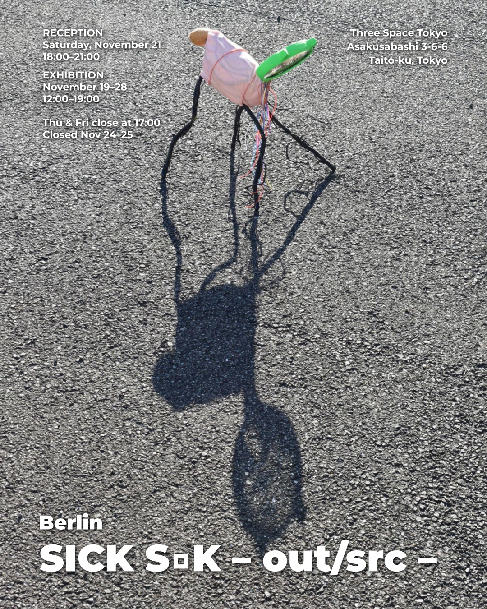

**Reception**: Saturday, November 21, 18:00–21:00  
**Exhibition**: November 19–28, 12:00–19:00 (Thu & Fri until 17:00; closed Nov 24–25)  
**Artist**: Berlin ([@berlin_bucchigiri](https://www.instagram.com/berlin_bucchigiri/))

Sick S□k - out/src - presents installations by Berlin across Three Space Tokyo’s three floors, exploring how individuals and society shape one another.

Humans have created systems and values to understand the world and relate to others. While these sustain society, they also blur the boundary between our own intentions and socially shaped values. The title “out/src” evokes “outsource,” bringing together the external world (“out”) and the source of individual thought and judgment (“src”).

Through labelled fish connected by tubes, disordered meeting tables, ceramic figures bearing traces of removed labels, and a fictional promotional event for a luxury fruit, the exhibition examines living within social structures, searching for ways to engage with them, and entrusting ourselves to their mechanisms.

Berlin is a Tokyo-based artist duo formed in 2019. Focusing on the “invisible intolerance” concealed within society, they deliberately reconstruct it as kitsch, festive scenes that unsettle viewers’ perceptions. Their practice also examines the structures of human cognition. Taking the “Cognitive Revolution” approximately 70,000 years ago as a starting point, their ongoing Sick S□k series explores the contradiction that humanity has prospered through shared fictions while also becoming subordinate to them and resisting evolution.

本展「Sick S□k - out/src -」は、べるりんによるインスタレーションをThree Space Tokyoの3つの階に展開し、個人と社会が互いを形づくる関係を探ります。

人間は、世界を理解し、他者と関わるために、さまざまな仕組みや価値観をつくり出してきました。それらは社会を成り立たせる一方で、私たち自身の意思と、社会の中で形づくられた価値観との境界を曖昧にしています。「out/src」は「outsource（外部委託）」を想起させるタイトル。「out」は個人を取り巻く外部を、「src」は思考や判断の源を表しています。

チューブでつながれた魚、乱れたミーティングテーブル、ラベルの剥がし跡が残る陶器、そして高級果実の架空の販促イベント。これらの光景を通して、社会の構造と関わりながら生きること、構造との関わりを模索すること、そしてその仕組みに身を委ねることなど、人間と社会のさまざまな関係を描きます。

べるりんは2019年に結成された、東京を拠点に活動する2人組。社会の深層に潜む「不可視の不寛容」に着目し、それらをあえてキッチュな祝祭的光景へと再構築することで、観者の認知に揺らぎをもたらす作品を制作しています。その背景にある人間の認知構造にも関心を寄せ、現在は、約7万年前の「認知革命」を起点に、人類が虚構を共有することで繁栄してきた一方、その虚構に隷属し、進化を拒むという矛盾を主題とする『Sick S□k』シリーズの制作を続けています。

[Works Available for Purchase](/works/#berlin-2026)
