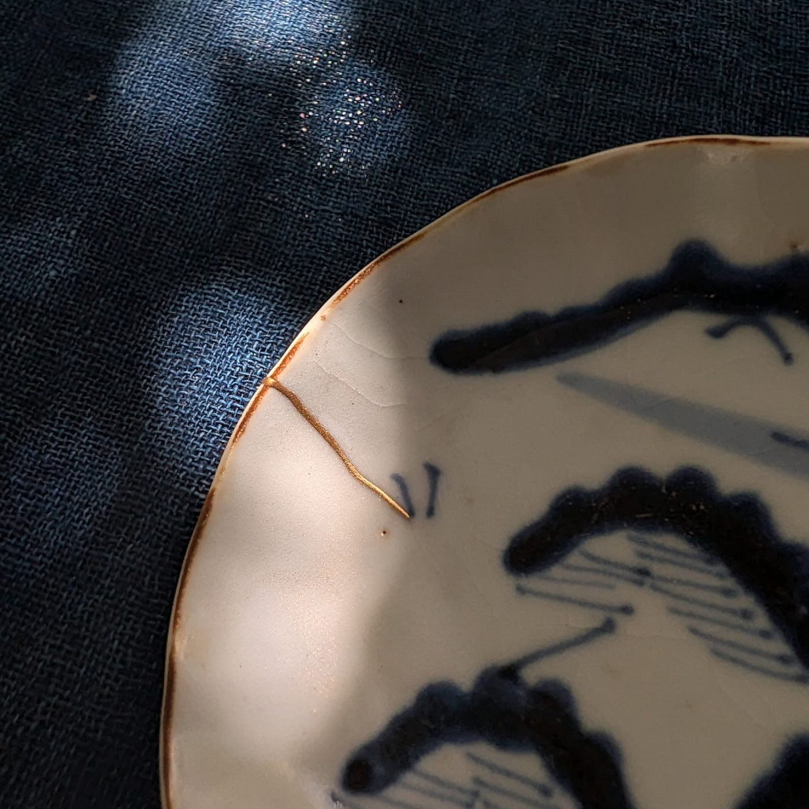
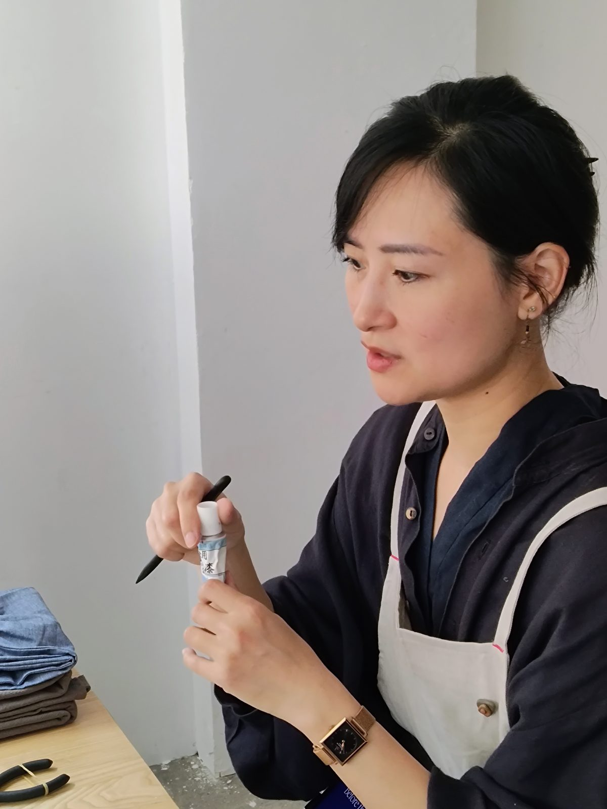





  
A small-group, English-speaking kintsugi workshop · natural urushi and real gold · Asakusabashi, Tokyo

  
Spend two quiet hours finishing a real kintsugi repair with your own hands. In a small group of up to four guests, you paint a line of urushi along the seam of an antique vessel, sprinkle it with gold, and take the piece home. Taught in English, for beginners and visitors to Tokyo alike.

  
<a class="btn-gold" href="#sessions">View dates &amp; book</a> &nbsp; <a class="btn-line" href="#location">Where we are</a>

  
<b>Duration</b>2 hours

  
<b>Group size</b>Max. 4 guests

  
<b>Price</b>¥20,000 per person

  
<b>Level</b>Beginners welcome

  
<b>Age</b>12 and over

  
<b>Language</b>English French, Japanese or Vietnamese on request

<h2>About kintsugi</h2>

  

    
Kintsugi (金継ぎ, “golden joinery”) is the traditional Japanese art of repairing broken ceramics with urushi lacquer and gold. Rather than hiding the break, it makes the repair part of the piece’s story. The craft has its roots in Japan’s tea culture and in lacquer techniques that go back thousands of years.

    
We work only with real materials: natural urushi and real gold. No epoxy, no synthetic substitutes. Every vessel is an antique piece, sourced and prepared by your teacher.

  

  

<h2>What you will do</h2>

A traditional kintsugi repair unfolds over weeks. Before each workshop, Lynh sources the vessels and completes the earlier stages of the repair, so that during the session you can carry out the final, most rewarding step yourself.

<ol class="steps">
  <li><strong>Discover the process.</strong> A short introduction to kintsugi, urushi and the stages of a traditional repair.</li>
  <li><strong>Choose your vessel.</strong> Each guest works on an antique dish or cup whose crack has already been filled and prepared.</li>
  <li><strong>Paint the seam.</strong> With a fine brush, you trace a line of urushi along the repair.</li>
  <li><strong>Sprinkle the gold.</strong> Using the maki-e technique, you dust gold powder onto the wet lacquer and watch the seam turn to gold.</li>
  <li><strong>Take it home.</strong> Your piece is packed in a protective box, with aftercare instructions for the weeks ahead.</li>
</ol>

The atmosphere is slow and focused: a quiet time, one task at a time. It is a cultural experience as much as a craft class, and no experience is needed. Aprons, arm covers and gloves are provided.



<h2>Your teacher</h2>

  
  

    
<strong>Lynh Ko</strong> · <a href="https://www.instagram.com/lynh.ko/" target="_blank" rel="noopener">@lynh.ko</a>

    
Lynh Ko is a kintsugi artist and tea ceremony practitioner based in Tokyo. Her small-group kintsugi workshops, taught in English and French, explore the deep focus that emerges through making: slow hands, quiet mind. Through traditional urushi techniques, she invites participants to experience kintsugi not only as a craft, but as a practice of giving full attention to the process.

  

<h2 id="sessions">Upcoming sessions</h2>

Sessions are <strong>10:00–12:00</strong> or <strong>14:00–16:00</strong> on the dates below, with a maximum of four guests each. Private sessions and other dates are available on request.



Payment is by card through Square at the time of booking. Dates marked “Book by email” are confirmed by reply with a payment link. Can’t find a date that works? <a href="mailto:threespacetokyo@gmail.com?subject=Mendtokyo%20-%20other%20dates">Write to us</a>.

<h2>Good to know</h2>

What is included?

One antique vessel prepared for you, all materials including natural urushi and real gold, tools, apron, arm covers and gloves, and protective packaging with aftercare instructions.

Which language is the workshop in?

The workshop is held in English. Sessions in French, Japanese or Vietnamese can be arranged — please <a href="mailto:threespacetokyo@gmail.com?subject=Mendtokyo%20-%20language">contact us</a> before booking.

What should I bring?

Nothing is required — aprons, arm covers and gloves are provided. Wear clothes you don’t mind getting a spot of lacquer on. If you use glasses for close-up work, do bring them: you will be drawing very fine lines.

Can I bring my own broken piece?

Not in this format — a full traditional repair takes several weeks of curing between layers, so each guest works on a vessel we prepare in advance. If you would like a personal piece repaired, <a href="mailto:threespacetokyo@gmail.com?subject=Kintsugi%20repair%20enquiry">get in touch</a> and we can discuss it separately.

A note on urushi

This workshop uses real Japanese urushi lacquer, a natural tree sap which may cause skin irritation or an allergic reaction in some people before it has cured. Protective gloves, arm covers and aprons are provided. By taking part, participants accept responsibility for any adverse reaction resulting from contact with urushi. If you have reacted to lacquer, mango or cashew (related plants) in the past, please tell us before booking.

Caring for your piece at home

Urushi is a living material and needs time to cure. Leave your piece in its box for at least a week somewhere warm and humid, then enjoy it as a decorative piece for two to three months before using it as tableware. After that: no dishwasher, no microwave, no soaking — wash gently by hand and dry with a soft cloth. You receive full aftercare instructions at the end of the workshop.

Age

Guests must be 12 or older. Guests aged 12–15 should be accompanied by a participating adult.

Cancellations

Free cancellation up to 24 hours before the session. After that the seat is non-refundable, but you may transfer it to someone else. If we have to cancel, you receive a full refund. Bookings made through other platforms are subject to that platform’s cancellation policy.

Private sessions &amp; larger groups

Each session takes a maximum of four guests. Book all four seats of an open session for a private workshop, or <a href="mailto:threespacetokyo@gmail.com?subject=Mendtokyo%20group%20booking">contact us</a> for groups larger than four or for other dates and times.

<h2 id="location">Location</h2>

  

    
<strong>Held at Three Space Tokyo</strong> 
    3-6-6 Asakusabashi, Taito-ku, Tokyo 111-0053 
    東京都台東区浅草橋3-6-6

    
About 6 minutes on foot from <strong>Asakusabashi Station</strong> (JR Sobu Line / Toei Asakusa Line, exit A4). From Akihabara it is one stop on the Sobu Line.

    
<a class="btn-line" href="https://maps.app.goo.gl/4ShWV12RVVhVmNTi6" target="_blank" rel="noopener">Open in Google Maps</a>

    
Questions: <a href="mailto:threespacetokyo@gmail.com">threespacetokyo@gmail.com</a> 
    Instagram: <a href="https://www.instagram.com/mendtokyo" target="_blank" rel="noopener">@mendtokyo</a> · <a href="https://www.instagram.com/threespacetokyo/" target="_blank" rel="noopener">@threespacetokyo</a>

  

  

Mendtokyo is a collaboration between kintsugi artist Lynh Ko and Three Space Tokyo.

