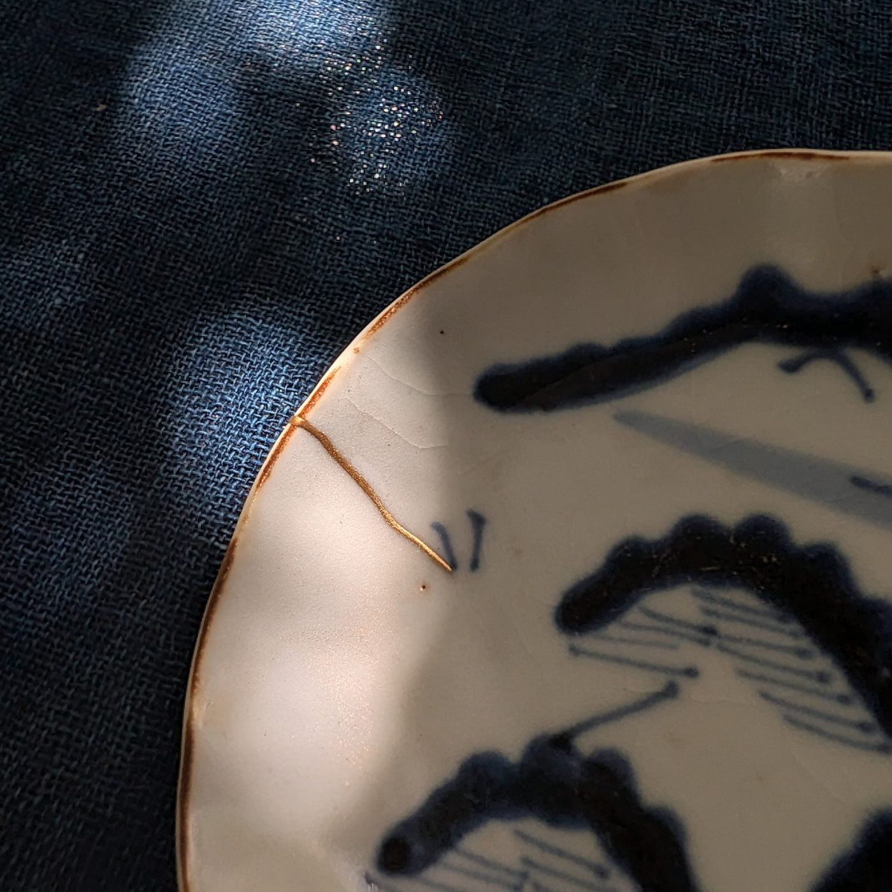
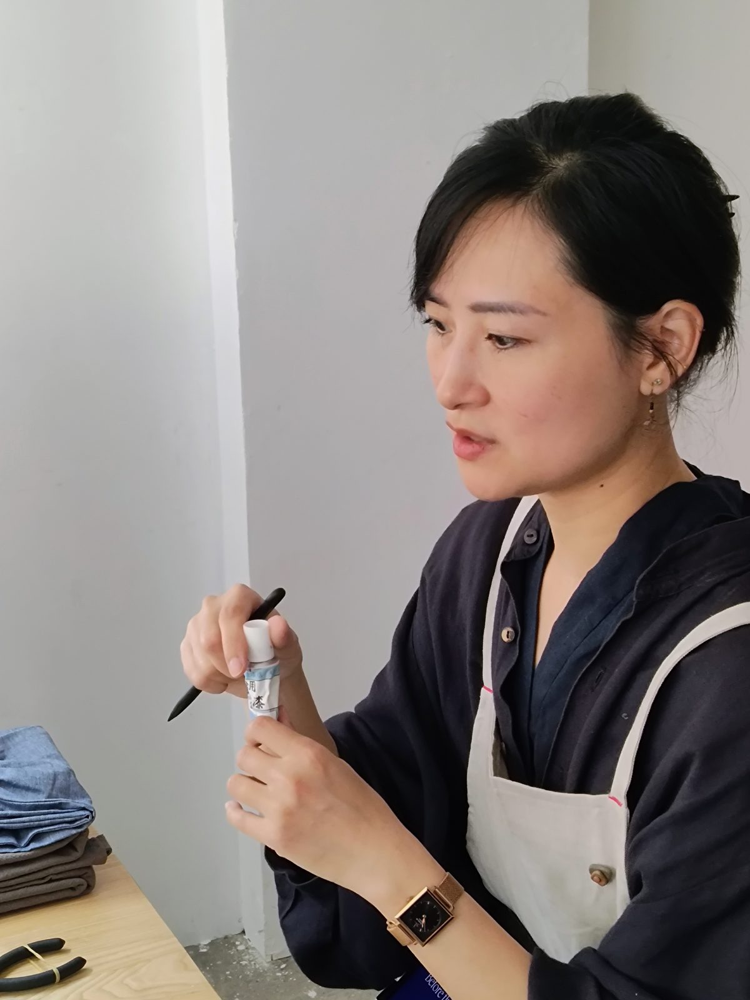





  
Atelier de kintsugi en petit groupe · urushi naturel et or véritable · Asakusabashi, Tokyo

  
Deux heures de calme pour achever, de vos propres mains, une véritable réparation au kintsugi. En petit groupe de quatre personnes au plus, vous tracez une ligne d’urushi le long de la fêlure d’une pièce ancienne, y déposez de la poudre d’or, puis emportez l’objet chez vous. L’atelier se déroule en anglais ; des séances en français sont possibles sur demande. Aucune expérience nécessaire.

  
<a class="btn-gold" href="#sessions">Dates &amp; réservation</a> &nbsp; <a class="btn-line" href="#location">Où nous trouver</a>

  
<b>Durée</b>2 heures

  
<b>Groupe</b>4 personnes max.

  
<b>Prix</b>20 000 ¥ par personne

  
<b>Niveau</b>Débutants bienvenus

  
<b>Âge</b>À partir de 12 ans

  
<b>Langue</b>Anglais français, japonais ou vietnamien sur demande

<h2>Le kintsugi</h2>

  

    
Le kintsugi (金継ぎ, « jointure d’or ») est l’art traditionnel japonais de réparer les céramiques brisées avec de la laque urushi et de l’or. Plutôt que de dissimuler la cassure, il en fait une partie de l’histoire de l’objet. Cette pratique puise ses racines dans la culture du thé et dans des techniques de laque vieilles de plusieurs millénaires.

    
Nous ne travaillons qu’avec des matériaux authentiques : urushi naturel et or véritable. Pas d’époxy, pas de substitut synthétique. Chaque pièce est un objet ancien, choisi et préparé par votre enseignante.

  

  

<h2>Ce que vous ferez</h2>

Une réparation traditionnelle au kintsugi s’étale sur plusieurs semaines. Avant chaque atelier, Lynh sélectionne les pièces et réalise les premières étapes de la réparation, afin que vous puissiez accomplir vous-même l’étape finale, la plus gratifiante.

<ol class="steps">
  <li><strong>Découvrir la technique.</strong> Une courte introduction au kintsugi, à l’urushi et aux étapes d’une réparation traditionnelle.</li>
  <li><strong>Choisir sa pièce.</strong> Chaque participant·e travaille sur une coupelle ou une tasse ancienne dont la fêlure a déjà été comblée et préparée.</li>
  <li><strong>Peindre la ligne.</strong> Au pinceau fin, vous tracez une ligne d’urushi le long de la réparation.</li>
  <li><strong>Saupoudrer l’or.</strong> Selon la technique du maki-e, vous déposez la poudre d’or sur la laque encore fraîche et voyez la ligne se transformer en or.</li>
  <li><strong>Repartir avec sa pièce.</strong> Votre objet est emballé dans une boîte de protection, avec les consignes d’entretien pour les semaines à venir.</li>
</ol>

L’ambiance est lente et concentrée : un moment de calme, un geste à la fois. C’est autant une expérience culturelle qu’un cours d’artisanat, et aucune expérience n’est nécessaire. Tabliers, manchettes et gants sont fournis.



<h2>Votre enseignante</h2>

  
  

    
<strong>Lynh Ko</strong> · <a href="https://www.instagram.com/lynh.ko/" target="_blank" rel="noopener">@lynh.ko</a>

    
Lynh Ko est une artiste kintsugi et pratiquante de la cérémonie du thé installée à Tokyo. Ses ateliers en petit groupe, donnés en anglais et en français, explorent la concentration profonde qui naît du faire : mains lentes, esprit tranquille. À travers les techniques traditionnelles de l’urushi, elle invite les participant·es à vivre le kintsugi non seulement comme un artisanat, mais comme une pratique de l’attention pleine portée au geste.

  

<h2 id="sessions">Prochaines séances</h2>

Les séances ont lieu de <strong>10 h à 12 h</strong> ou de <strong>14 h à 16 h</strong> aux dates ci-dessous, avec quatre participant·es au maximum. Séances privées et autres dates possibles sur demande.



Le paiement s’effectue par carte via Square au moment de la réservation. Pour les dates « Réserver par e-mail », nous confirmons par retour avec un lien de paiement. Aucune date ne vous convient ? <a href="mailto:threespacetokyo@gmail.com?subject=Mendtokyo%20-%20autres%20dates">Écrivez-nous</a>.

<h2>Bon à savoir</h2>

Qu’est-ce qui est inclus ?

Une pièce ancienne préparée pour vous, tout le matériel (urushi naturel et or véritable compris), les outils, tablier, manchettes et gants, ainsi qu’un emballage de protection avec les consignes d’entretien.

Dans quelle langue se déroule l’atelier ?

L’atelier se déroule en anglais. Des séances en français, en japonais ou en vietnamien peuvent être organisées : <a href="mailto:threespacetokyo@gmail.com?subject=Mendtokyo%20-%20langue">contactez-nous</a> avant de réserver.

Que dois-je apporter ?

Rien n’est nécessaire : tabliers, manchettes et gants sont fournis. Portez des vêtements qui ne craignent pas une tache de laque. Si vous utilisez des lunettes pour le travail de près, pensez à les apporter : vous tracerez des lignes très fines.

Puis-je apporter mon propre objet cassé ?

Pas dans ce format : une réparation traditionnelle complète demande plusieurs semaines de séchage entre les couches, c’est pourquoi chaque participant·e travaille sur une pièce que nous préparons à l’avance. Si vous souhaitez faire réparer un objet personnel, <a href="mailto:threespacetokyo@gmail.com?subject=Demande%20de%20r%C3%A9paration%20kintsugi">écrivez-nous</a> et nous en parlerons séparément.

À propos de l’urushi

Cet atelier utilise de la véritable laque japonaise urushi, une sève naturelle qui peut provoquer, avant séchage, une irritation cutanée ou une réaction allergique chez certaines personnes. Gants, manchettes et tabliers de protection sont fournis. En participant, chacun·e accepte la responsabilité de toute réaction indésirable liée au contact avec l’urushi. Si vous avez déjà réagi à la laque, à la mangue ou à la noix de cajou (plantes apparentées), merci de nous le signaler avant de réserver.

Entretenir sa pièce à la maison

L’urushi est une matière vivante qui a besoin de temps pour durcir. Laissez votre pièce dans sa boîte au moins une semaine dans un endroit chaud et humide, puis gardez-la comme objet décoratif pendant deux à trois mois avant de l’utiliser à table. Ensuite : pas de lave-vaisselle, pas de micro-ondes, pas de trempage — lavez délicatement à la main et séchez avec un chiffon doux. Les consignes d’entretien complètes vous sont remises à la fin de l’atelier.

Âge

À partir de 12 ans. Les 12–15 ans doivent être accompagnés d’un adulte participant.

Annulation

Annulation gratuite jusqu’à 24 heures avant la séance. Au-delà, la place n’est pas remboursable mais peut être cédée à une autre personne. Si nous devons annuler, vous êtes intégralement remboursé·e. Les réservations effectuées via d’autres plateformes sont soumises aux conditions d’annulation de ces plateformes.

Séances privées &amp; groupes

Chaque séance accueille quatre personnes au maximum. Réservez les quatre places d’une séance ouverte pour un atelier privé, ou <a href="mailto:threespacetokyo@gmail.com?subject=Mendtokyo%20groupe">contactez-nous</a> pour un groupe plus nombreux ou d’autres dates et horaires.

<h2 id="location">Lieu</h2>

  

    
<strong>À Three Space Tokyo</strong> 
    3-6-6 Asakusabashi, Taito-ku, Tokyo 111-0053 
    東京都台東区浅草橋3-6-6

    
À environ 6 minutes à pied de la gare d’<strong>Asakusabashi</strong> (ligne JR Sobu / ligne Toei Asakusa, sortie A4). Depuis Akihabara, c’est une station sur la ligne Sobu.

    
<a class="btn-line" href="https://maps.app.goo.gl/4ShWV12RVVhVmNTi6" target="_blank" rel="noopener">Ouvrir dans Google Maps</a>

    
Questions : <a href="mailto:threespacetokyo@gmail.com">threespacetokyo@gmail.com</a> 
    Instagram : <a href="https://www.instagram.com/mendtokyo" target="_blank" rel="noopener">@mendtokyo</a> · <a href="https://www.instagram.com/threespacetokyo/" target="_blank" rel="noopener">@threespacetokyo</a>

  

  

Mendtokyo est une collaboration entre l’artiste kintsugi Lynh Ko et Three Space Tokyo.

