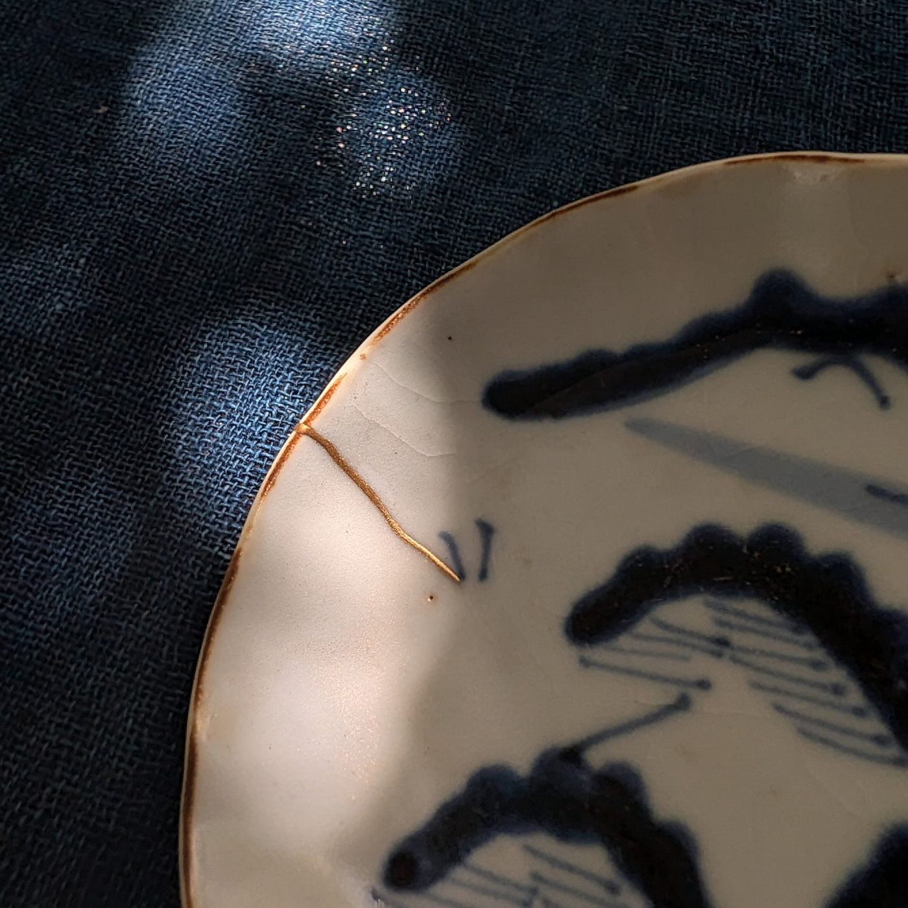
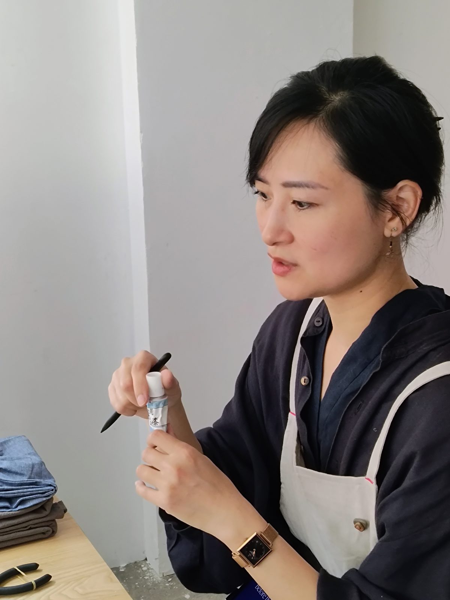





  
少人数の金継ぎワークショップ · 本漆と本金 · 東京・浅草橋

  
静かな2時間で、本物の金継ぎの仕上げをご自身の手で行います。最大4名の少人数で、古い器のひびに沿って漆の線を引き、金粉を蒔き、仕上がった器をそのままお持ち帰りいただけます。基本は英語で進行しますが、日本語での開催もご相談ください。初めての方も歓迎です。

  
<a class="btn-gold" href="#sessions">日程・ご予約</a> &nbsp; <a class="btn-line" href="#location">アクセス</a>

  
<b>所要時間</b>2時間

  
<b>定員</b>各回4名まで

  
<b>料金</b>お一人 20,000円

  
<b>レベル</b>初心者歓迎

  
<b>年齢</b>12歳以上

  
<b>言語</b>英語 日本語・フランス語・ベトナム語はご相談ください

<h2>金継ぎについて</h2>

  

    
金継ぎは、割れたり欠けたりした器を漆と金で繕う日本の伝統的な修復技法です。傷を隠すのではなく、繕いの跡を器の歴史の一部として生かします。その背景には茶の湯の文化と、数千年にわたる漆の技術があります。

    
使うのは本物の素材だけ——天然の漆と本金です。エポキシや合成の代用品は使いません。器はすべて講師が選び、下準備をした古い器です。

  

  

<h2>当日の流れ</h2>

伝統的な金継ぎは、何週間もかけて進める作業です。講師のLynhが事前に器を選び、繕いの前半の工程を終えておきますので、当日は最後の、いちばん楽しい仕上げの工程をご自身で行っていただきます。

<ol class="steps">
  <li><strong>金継ぎを知る。</strong> 金継ぎと漆、伝統的な修復の工程についての短い紹介。</li>
  <li><strong>器を選ぶ。</strong> ひびをすでに埋めて整えてある古い小皿や猪口の中から、お一人一点を選びます。</li>
  <li><strong>線を引く。</strong> 細い筆で、繕いの跡に沿って漆の線を引きます。</li>
  <li><strong>金を蒔く。</strong> 蒔絵の技法で、乾く前の漆に金粉を蒔き、線が金に変わっていく様子を見届けます。</li>
  <li><strong>持ち帰る。</strong> 器は保護用の箱に入れ、これから数週間のお手入れの説明書を添えてお渡しします。</li>
</ol>

ゆっくりと集中した時間——一つの作業に静かに向き合うひとときです。手仕事の教室であると同時に文化体験でもあり、経験は必要ありません。エプロン、アームカバー、手袋をご用意しています。



<h2>講師</h2>

  
  

    
<strong>Lynh Ko</strong> · <a href="https://www.instagram.com/lynh.ko/" target="_blank" rel="noopener">@lynh.ko</a>

    
Lynh Ko（リン・コー）は東京を拠点とする金継ぎ作家で、茶道も学んでいます。英語とフランス語で行う少人数のワークショップでは、つくることを通して生まれる深い集中——ゆっくりとした手、静かな心——を大切にしています。伝統的な漆の技法を通して、金継ぎを工芸としてだけでなく、目の前の工程にまるごと注意を向ける実践として体験していただきます。

  

<h2 id="sessions">今後の日程</h2>

各回 <strong>10:00–12:00</strong> または <strong>14:00–16:00</strong>、定員4名です。貸切開催やその他の日程はご相談ください。



お支払いはご予約時にSquareでのカード決済となります。「メールで予約」の回は、返信にて決済リンクをお送りして確定します。ご都合の合う日程がない場合は<a href="mailto:threespacetokyo@gmail.com?subject=Mendtokyo%20-%20%E3%81%9D%E3%81%AE%E4%BB%96%E3%81%AE%E6%97%A5%E7%A8%8B">お問い合わせください</a>。

<h2>ご参加にあたって</h2>

料金に含まれるもの

お一人一点の下準備済みの古い器、天然漆と本金を含むすべての材料、道具、エプロン・アームカバー・手袋、お手入れ説明書付きの保護箱。

何語で行われますか？

基本は英語で進行します。日本語、フランス語、ベトナム語での開催もご相談に応じますので、ご予約前に<a href="mailto:threespacetokyo@gmail.com?subject=Mendtokyo%20-%20%E8%A8%80%E8%AA%9E">ご連絡ください</a>。

持ち物はありますか？

特にありません。エプロン、アームカバー、手袋はこちらでご用意します。漆が少し付いても気にならない服装でお越しください。細かい線を描きますので、手元を見る際に眼鏡をお使いの方はぜひお持ちください。

自分の割れた器を持ち込めますか？

このワークショップではお受けしていません。本格的な金継ぎは層ごとに乾かす時間が必要で数週間かかるため、事前に準備した器で行います。ご自身の器の修復をご希望の場合は、別途<a href="mailto:threespacetokyo@gmail.com?subject=%E9%87%91%E7%B6%99%E3%81%8E%E4%BF%AE%E5%BE%A9%E3%81%AE%E3%81%94%E7%9B%B8%E8%AB%87">ご相談ください</a>。

漆についてのご注意

本ワークショップでは本物の日本の漆を使います。漆は天然の樹液で、乾く前に触れると、体質によってはかぶれやアレルギー反応を起こすことがあります。保護用の手袋、アームカバー、エプロンをご用意しています。ご参加にあたっては、漆との接触による反応について参加者ご自身の責任となることをご了承ください。過去に漆やマンゴー、カシューナッツ（同じ仲間の植物）で反応が出たことのある方は、ご予約前にお知らせください。

お持ち帰り後のお手入れ

漆は生きた素材で、固まるのに時間がかかります。お持ち帰り後は少なくとも1週間、暖かく湿度のある場所で箱に入れたまま置き、その後2〜3か月は飾って楽しんでから食器としてお使いください。その後も食洗機・電子レンジ・つけ置き洗いは避け、やわらかいスポンジで手洗いし、柔らかい布で拭いてください。詳しいお手入れ方法はワークショップの最後にお渡しします。

年齢

12歳以上の方が対象です。12〜15歳の方は、一緒に参加される大人の方の同伴をお願いします。

キャンセルについて

開始24時間前までは無料でキャンセルできます。それ以降の返金はできませんが、他の方への譲渡は可能です。主催者都合で中止となった場合は全額返金いたします。他のプラットフォームを通じたご予約には、各プラットフォームのキャンセル規定が適用されます。

貸切・団体でのご参加

各回の定員は4名です。空きのある回の4席をまとめてご予約いただくと貸切になります。5名以上のグループやその他の日時については<a href="mailto:threespacetokyo@gmail.com?subject=Mendtokyo%20%E5%9B%A3%E4%BD%93%E4%BA%88%E7%B4%84">お問い合わせください</a>。

<h2 id="location">アクセス</h2>

  

    
<strong>会場：Three Space Tokyo</strong> 
    東京都台東区浅草橋3-6-6 
    3-6-6 Asakusabashi, Taito-ku, Tokyo 111-0053

    
<strong>浅草橋駅</strong>（JR総武線・都営浅草線、A4出口）から徒歩約6分。秋葉原から総武線で1駅です。

    
<a class="btn-line" href="https://maps.app.goo.gl/4ShWV12RVVhVmNTi6" target="_blank" rel="noopener">Googleマップで開く</a>

    
お問い合わせ：<a href="mailto:threespacetokyo@gmail.com">threespacetokyo@gmail.com</a> 
    Instagram：<a href="https://www.instagram.com/mendtokyo" target="_blank" rel="noopener">@mendtokyo</a> · <a href="https://www.instagram.com/threespacetokyo/" target="_blank" rel="noopener">@threespacetokyo</a>

  

  

Mendtokyoは、金継ぎ作家Lynh KoとThree Space Tokyoの共同企画です。

