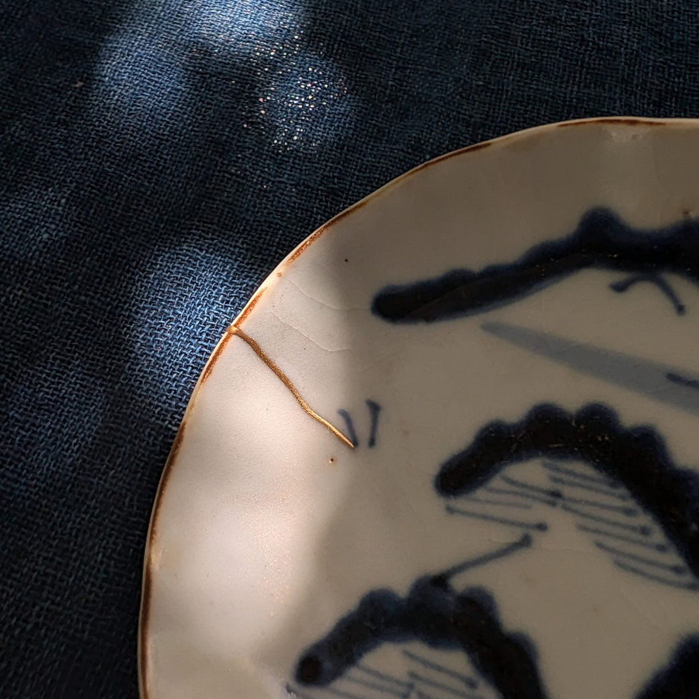
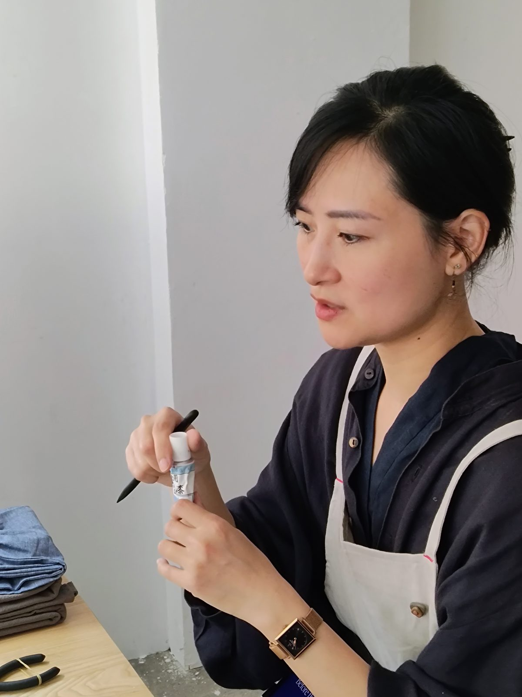





  
Workshop kintsugi nhóm nhỏ · sơn mài urushi tự nhiên và vàng thật · Asakusabashi, Tokyo

  
Hai giờ yên tĩnh để tự tay hoàn thiện một mối hàn kintsugi thật sự. Trong nhóm tối đa bốn người, bạn vẽ một đường urushi dọc theo vết nứt của một món đồ gốm cổ, rắc bột vàng lên, rồi mang món đồ về nhà. Workshop diễn ra bằng tiếng Anh; có thể tổ chức bằng tiếng Việt theo yêu cầu. Không cần kinh nghiệm.

  
<a class="btn-gold" href="#sessions">Lịch &amp; đặt chỗ</a> &nbsp; <a class="btn-line" href="#location">Địa điểm</a>

  
<b>Thời lượng</b>2 giờ

  
<b>Số người</b>Tối đa 4 khách

  
<b>Giá</b>¥20.000 / người

  
<b>Trình độ</b>Người mới bắt đầu

  
<b>Độ tuổi</b>Từ 12 tuổi

  
<b>Ngôn ngữ</b>Tiếng Anh tiếng Việt, Pháp hoặc Nhật theo yêu cầu

<h2>Về kintsugi</h2>

  

    
Kintsugi (金継ぎ, “nối bằng vàng”) là nghệ thuật truyền thống của Nhật Bản: hàn gắn đồ gốm vỡ bằng sơn mài urushi và vàng. Thay vì che giấu vết nứt, kintsugi biến vết sửa thành một phần câu chuyện của món đồ. Nghệ thuật này bắt nguồn từ văn hóa trà đạo và từ kỹ thuật sơn mài có lịch sử hàng nghìn năm.

    
Chúng tôi chỉ dùng vật liệu thật: urushi tự nhiên và vàng thật. Không epoxy, không chất thay thế tổng hợp. Mỗi món đồ đều là đồ cổ do giáo viên tự tìm chọn và chuẩn bị.

  

  

<h2>Bạn sẽ làm gì</h2>

Một mối hàn kintsugi truyền thống kéo dài nhiều tuần. Trước mỗi buổi, Lynh tìm chọn đồ gốm và hoàn thành các công đoạn đầu, để trong buổi học bạn tự tay thực hiện công đoạn cuối cùng — cũng là công đoạn thú vị nhất.

<ol class="steps">
  <li><strong>Tìm hiểu quy trình.</strong> Giới thiệu ngắn về kintsugi, urushi và các bước của một mối hàn truyền thống.</li>
  <li><strong>Chọn món đồ.</strong> Mỗi khách làm việc trên một chiếc đĩa hoặc chén cổ có vết nứt đã được trám và chuẩn bị sẵn.</li>
  <li><strong>Vẽ đường nối.</strong> Bằng cọ mảnh, bạn kẻ một đường urushi dọc theo vết sửa.</li>
  <li><strong>Rắc vàng.</strong> Theo kỹ thuật maki-e, bạn rắc bột vàng lên lớp sơn còn ướt và nhìn đường nối chuyển thành vàng.</li>
  <li><strong>Mang về nhà.</strong> Món đồ được đóng trong hộp bảo vệ, kèm hướng dẫn chăm sóc cho những tuần tiếp theo.</li>
</ol>

Không khí chậm rãi và tập trung: một khoảng lặng, mỗi lúc một việc. Đây vừa là lớp thủ công vừa là trải nghiệm văn hóa, và không đòi hỏi kinh nghiệm. Tạp dề, ống tay và găng tay được cung cấp.



<h2>Giáo viên</h2>

  
  

    
<strong>Lynh Ko</strong> · <a href="https://www.instagram.com/lynh.ko/" target="_blank" rel="noopener">@lynh.ko</a>

    
Lynh Ko là nghệ sĩ kintsugi và người thực hành trà đạo sống tại Tokyo. Các workshop nhóm nhỏ của cô, giảng bằng tiếng Anh và tiếng Pháp, khám phá sự tập trung sâu nảy sinh từ việc làm bằng tay: đôi tay chậm rãi, tâm trí tĩnh lặng. Qua kỹ thuật urushi truyền thống, cô mời người tham gia trải nghiệm kintsugi không chỉ như một nghề thủ công, mà như một thực hành dành trọn sự chú ý cho từng công đoạn.

  

<h2 id="sessions">Lịch sắp tới</h2>

Các buổi diễn ra từ <strong>10:00–12:00</strong> hoặc <strong>14:00–16:00</strong> vào các ngày dưới đây, tối đa bốn khách mỗi buổi. Có thể tổ chức buổi riêng hoặc ngày khác theo yêu cầu.



Thanh toán bằng thẻ qua Square khi đặt chỗ. Với các ngày “Đặt qua email”, chúng tôi sẽ xác nhận bằng thư trả lời kèm liên kết thanh toán. Không có ngày phù hợp? <a href="mailto:threespacetokyo@gmail.com?subject=Mendtokyo%20-%20ng%C3%A0y%20kh%C3%A1c">Hãy viết cho chúng tôi</a>.

<h2>Những điều cần biết</h2>

Bao gồm những gì?

Một món đồ gốm cổ đã chuẩn bị sẵn cho bạn, toàn bộ vật liệu gồm urushi tự nhiên và vàng thật, dụng cụ, tạp dề, ống tay và găng tay, cùng hộp bảo vệ kèm hướng dẫn chăm sóc.

Workshop dùng ngôn ngữ nào?

Workshop diễn ra bằng tiếng Anh. Có thể sắp xếp buổi bằng tiếng Việt, tiếng Pháp hoặc tiếng Nhật — vui lòng <a href="mailto:threespacetokyo@gmail.com?subject=Mendtokyo%20-%20ng%C3%B4n%20ng%E1%BB%AF">liên hệ</a> trước khi đặt chỗ.

Cần mang theo gì?

Không cần gì cả — tạp dề, ống tay và găng tay đã có sẵn. Hãy mặc trang phục không ngại dính một chút sơn. Nếu bạn dùng kính để nhìn gần, hãy mang theo: bạn sẽ vẽ những đường rất mảnh.

Tôi có thể mang đồ vỡ của mình đến không?

Không trong hình thức này — một mối hàn truyền thống hoàn chỉnh cần nhiều tuần để các lớp sơn khô, nên mỗi khách làm việc trên món đồ chúng tôi chuẩn bị trước. Nếu bạn muốn sửa một món đồ cá nhân, hãy <a href="mailto:threespacetokyo@gmail.com?subject=S%E1%BB%ADa%20kintsugi">liên hệ</a> để trao đổi riêng.

Lưu ý về urushi

Workshop sử dụng sơn mài urushi thật của Nhật Bản — một loại nhựa cây tự nhiên có thể gây kích ứng da hoặc dị ứng ở một số người khi chưa khô. Găng tay, ống tay và tạp dề bảo hộ được cung cấp. Khi tham gia, người tham gia tự chịu trách nhiệm về mọi phản ứng bất lợi do tiếp xúc với urushi. Nếu bạn từng dị ứng với sơn mài, xoài hoặc hạt điều (các loài cây họ hàng), vui lòng cho chúng tôi biết trước khi đặt chỗ.

Chăm sóc món đồ tại nhà

Urushi là vật liệu “sống” và cần thời gian để khô cứng. Hãy để món đồ trong hộp ít nhất một tuần ở nơi ấm và ẩm, rồi dùng làm đồ trang trí trong hai đến ba tháng trước khi dùng đựng thức ăn. Sau đó: không máy rửa bát, không lò vi sóng, không ngâm nước — rửa nhẹ bằng tay và lau khô bằng khăn mềm. Bạn sẽ nhận hướng dẫn chăm sóc đầy đủ vào cuối buổi.

Độ tuổi

Khách từ 12 tuổi trở lên. Khách 12–15 tuổi cần có người lớn cùng tham gia đi kèm.

Hủy đặt chỗ

Hủy miễn phí đến 24 giờ trước buổi học. Sau đó chỗ không được hoàn tiền nhưng có thể chuyển cho người khác. Nếu chúng tôi phải hủy, bạn được hoàn tiền đầy đủ. Đặt chỗ qua các nền tảng khác tuân theo chính sách hủy của nền tảng đó.

Buổi riêng &amp; nhóm đông hơn

Mỗi buổi tối đa bốn khách. Đặt cả bốn chỗ của một buổi còn trống để có workshop riêng, hoặc <a href="mailto:threespacetokyo@gmail.com?subject=Mendtokyo%20nh%C3%B3m">liên hệ</a> nếu nhóm đông hơn bốn người hoặc muốn ngày giờ khác.

<h2 id="location">Địa điểm</h2>

  

    
<strong>Tại Three Space Tokyo</strong> 
    3-6-6 Asakusabashi, Taito-ku, Tokyo 111-0053 
    東京都台東区浅草橋3-6-6

    
Khoảng 6 phút đi bộ từ ga <strong>Asakusabashi</strong> (tuyến JR Sobu / tuyến Toei Asakusa, lối ra A4). Từ Akihabara chỉ một ga trên tuyến Sobu.

    
<a class="btn-line" href="https://maps.app.goo.gl/4ShWV12RVVhVmNTi6" target="_blank" rel="noopener">Mở trong Google Maps</a>

    
Liên hệ: <a href="mailto:threespacetokyo@gmail.com">threespacetokyo@gmail.com</a> 
    Instagram: <a href="https://www.instagram.com/mendtokyo" target="_blank" rel="noopener">@mendtokyo</a> · <a href="https://www.instagram.com/threespacetokyo/" target="_blank" rel="noopener">@threespacetokyo</a>

  

  

Mendtokyo là dự án hợp tác giữa nghệ sĩ kintsugi Lynh Ko và Three Space Tokyo.

