

### SICK S□K - out/src - — Berlin (2026)

**[Exhibition Page](/exhibitions/berlin-sick-sok-out-src/)**

*Farrago* works can be purchased individually at ¥22,000 each, or as the complete 5-piece set for ¥90,000. *ネコ* is available as a single piece for ¥55,000, or as a 3-piece set for ¥135,000. All prices include tax.

<table>
<tr>
<td align="center" valign="bottom" width="33%" height="420">
<a href="/assets/berlin-sick-sok-out-src/ail.jpg?full" target="_blank" rel="noopener" title="Open larger image in a new window">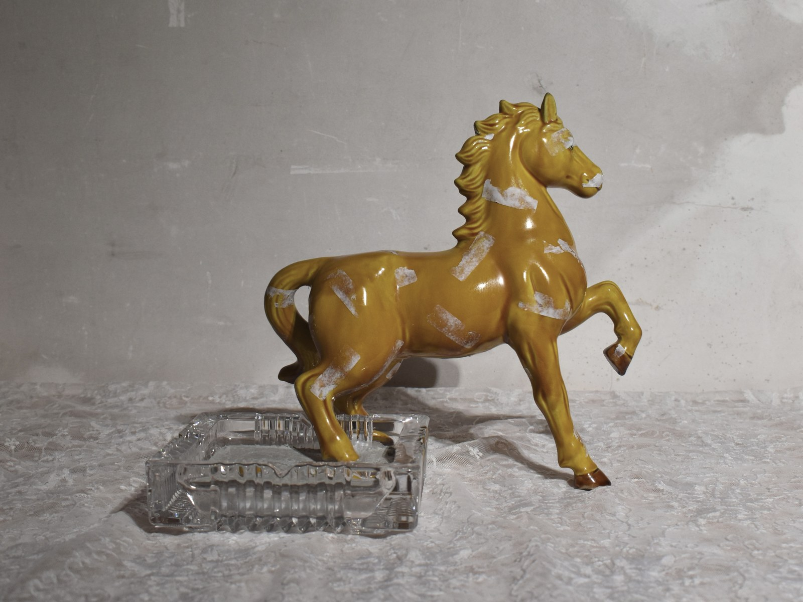</a>  
<b>Ail</b> 
2026 
Ceramic, Ashtray, Concrete, Label 
¥22,000  
<a href="https://square.link/u/5gyd9kHB">Purchase Work</a>
</td>

<td align="center" valign="bottom" width="33%" height="420">
<a href="/assets/berlin-sick-sok-out-src/paddle.jpg?full" target="_blank" rel="noopener" title="Open larger image in a new window">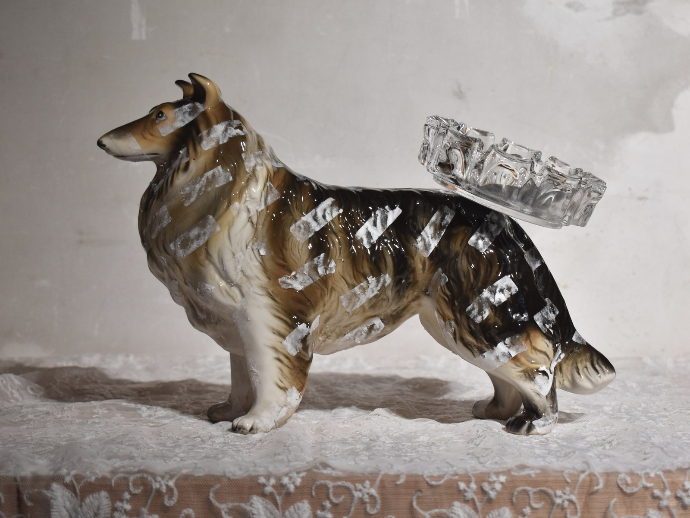</a>  
<b>Paddle</b> 
2026 
Ceramic, Ashtray, Concrete, Label 
¥22,000  
<a href="https://square.link/u/vvBPkuds">Purchase Work</a>
</td>

<td align="center" valign="bottom" width="33%" height="420">
<a href="/assets/berlin-sick-sok-out-src/ballet.jpg?full" target="_blank" rel="noopener" title="Open larger image in a new window">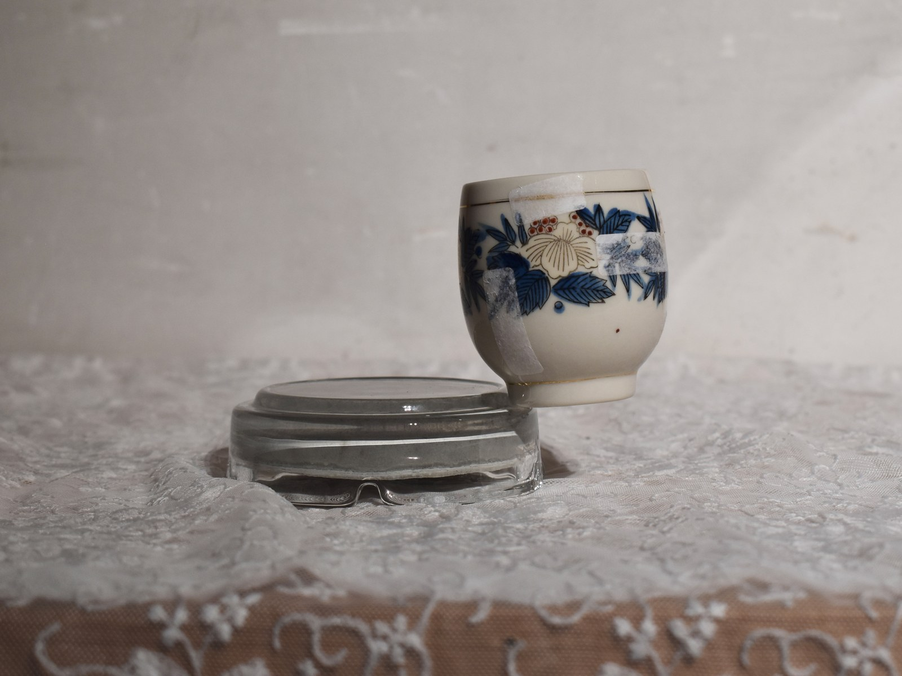</a>  
<b>Ballet</b> 
2026 
Ceramic, Ashtray, Concrete, Label 
¥22,000  
<a href="https://square.link/u/toAKm7ZZ">Purchase Work</a>
</td>
</tr>

<tr>
<td align="center" valign="bottom" width="33%" height="420">
<a href="/assets/berlin-sick-sok-out-src/snake.jpg?full" target="_blank" rel="noopener" title="Open larger image in a new window">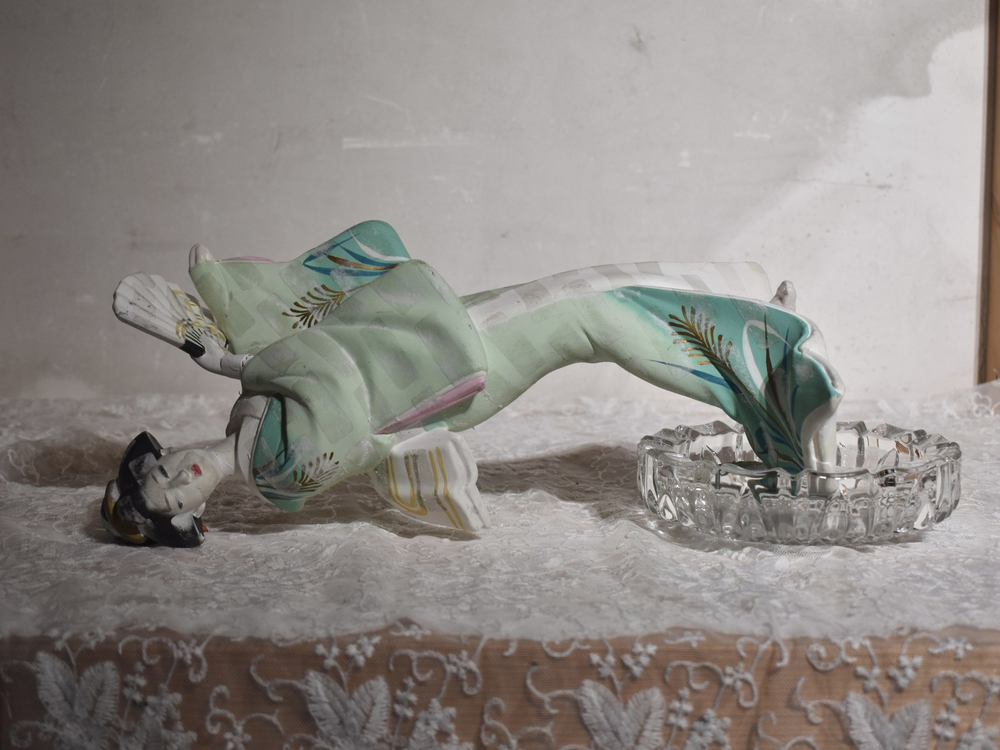</a>  
<b>Snake</b> 
2026 
Ceramic, Ashtray, Concrete, Label 
¥22,000  
<a href="https://square.link/u/idrTCw7z">Purchase Work</a>
</td>

<td align="center" valign="bottom" width="33%" height="420">
<a href="/assets/berlin-sick-sok-out-src/split.jpg?full" target="_blank" rel="noopener" title="Open larger image in a new window">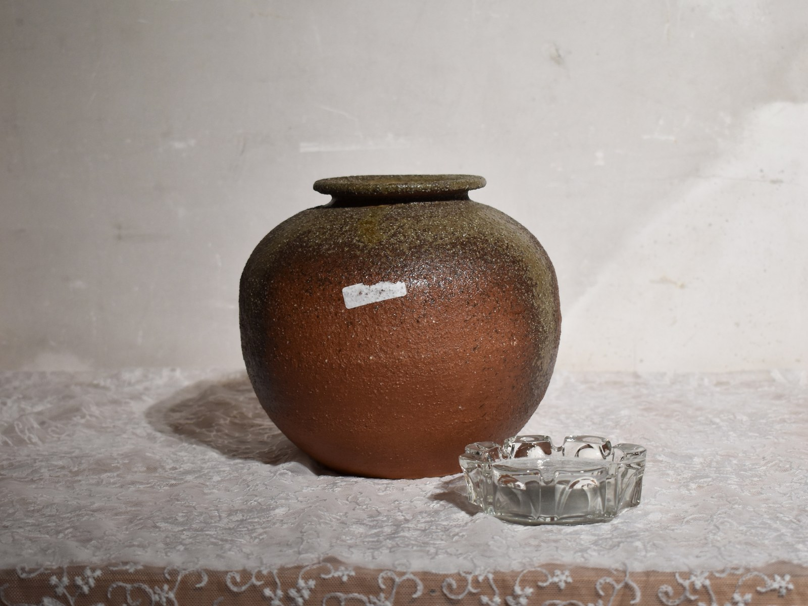</a>  
<b>Split</b> 
2026 
Ceramic, Ashtray, Concrete, Label 
¥22,000  
<a href="https://square.link/u/CztYwmwz">Purchase Work</a>
</td>

<td align="center" valign="bottom" width="33%" height="420">
<a href="/assets/berlin-sick-sok-out-src/vertical.jpg?full" target="_blank" rel="noopener" title="Open larger image in a new window">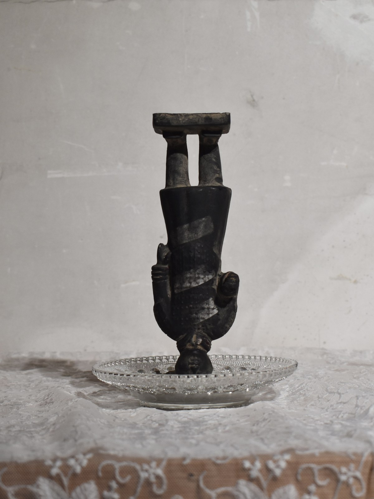</a>  
<b>Vertical</b> 
2026 
Ceramic, Ashtray, Concrete, Label 
¥22,000  
<a href="https://square.link/u/W11kuYEh">Purchase Work</a>
</td>
</tr>

<tr>
<td align="center" valign="bottom" width="33%" height="420">
<a href="/assets/berlin-sick-sok-out-src/scull.jpg?full" target="_blank" rel="noopener" title="Open larger image in a new window">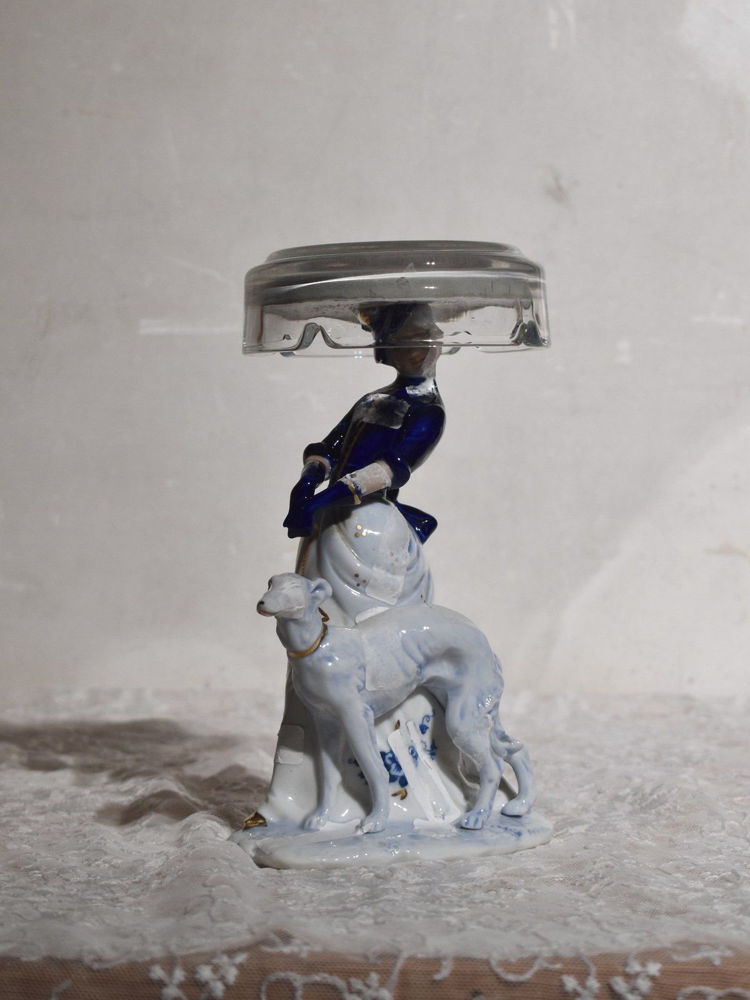</a>  
<b>Scull</b> 
2026 
Ceramic, Ashtray, Concrete, Label 
¥22,000  
<a href="https://square.link/u/APj6tSaP">Purchase Work</a>
</td>

<td align="center" valign="bottom" width="33%" height="420">
<a href="/assets/berlin-sick-sok-out-src/flamingo.jpg?full" target="_blank" rel="noopener" title="Open larger image in a new window">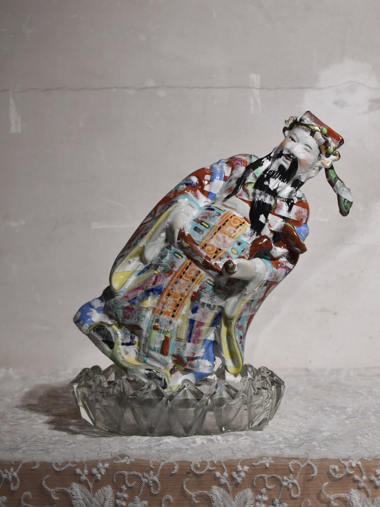</a>  
<b>Flamingo</b> 
2026 
Ceramic, Ashtray, Concrete, Label 
¥22,000  
<a href="https://square.link/u/gEpYmDbD">Purchase Work</a>
</td>

<td align="center" valign="bottom" width="33%" height="420">
<a href="/assets/berlin-sick-sok-out-src/crane.jpg?full" target="_blank" rel="noopener" title="Open larger image in a new window">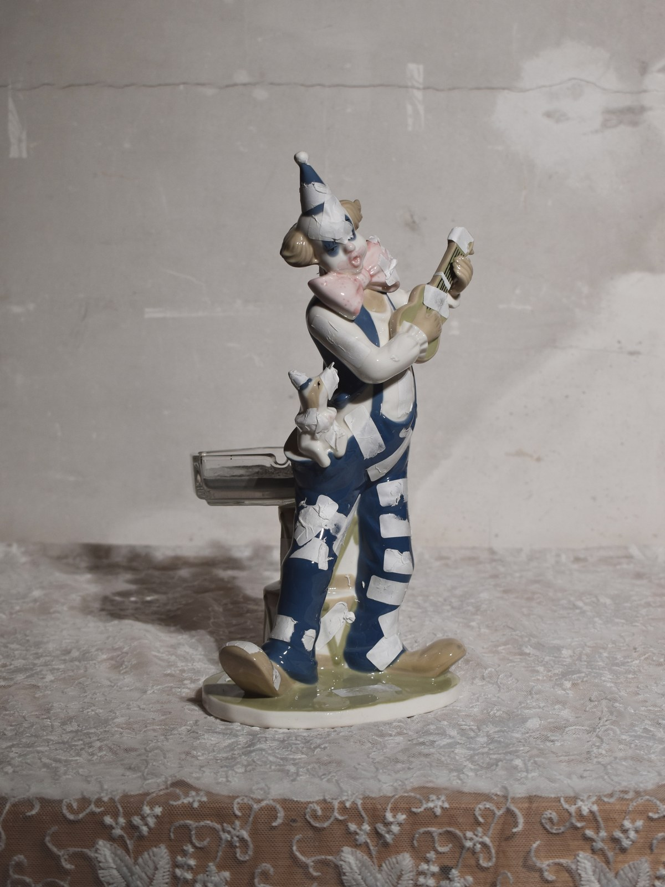</a>  
<b>Crane</b> 
2026 
Ceramic, Ashtray, Concrete, Label 
¥22,000  
<a href="https://square.link/u/W9ZU8dSz">Purchase Work</a>
</td>
</tr>

<tr>
<td align="center" valign="bottom" width="33%" height="420">
<a href="/assets/berlin-sick-sok-out-src/whip-kick.jpg?full" target="_blank" rel="noopener" title="Open larger image in a new window">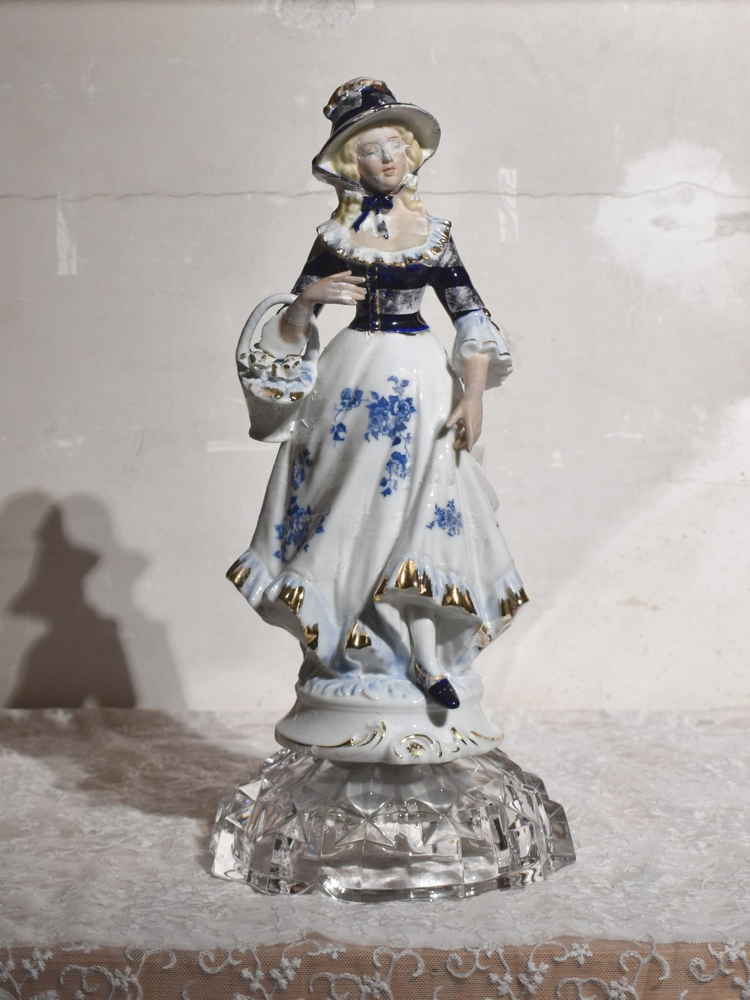</a>  
<b>Whip Kick</b> 
2026 
Ceramic, Ashtray, Concrete, Label 
¥22,000  
<a href="https://square.link/u/PXDmeGL6">Purchase Work</a>
</td>

<td align="center" valign="bottom" width="33%" height="420">
<a href="/assets/berlin-sick-sok-out-src/farrago-set.jpg?full" target="_blank" rel="noopener" title="Open larger image in a new window">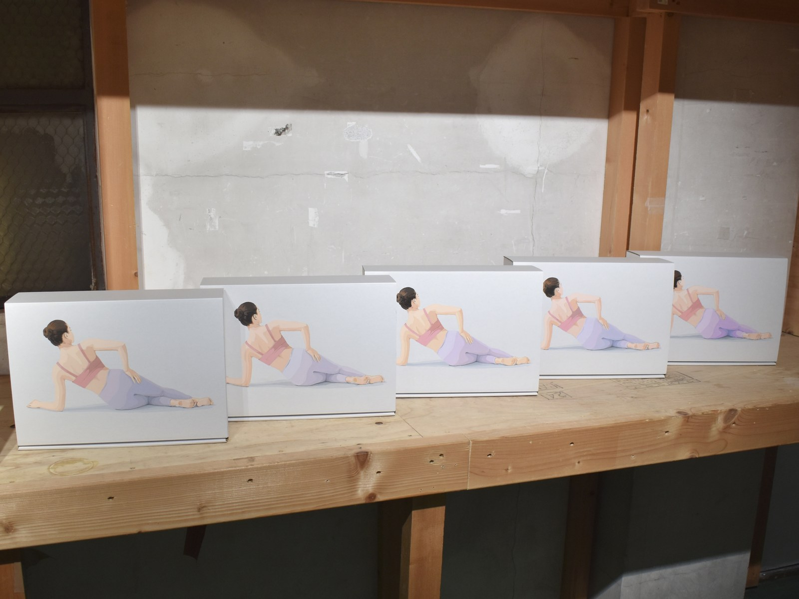</a>  
<b>Farrago — 5-piece set</b> 
2026 
Acrylic paint, Painted on a box 
¥90,000  
<a href="https://square.link/u/2bL0AakZ">Purchase Work</a>
</td>

<td align="center" valign="bottom" width="33%" height="420">
<a href="/assets/berlin-sick-sok-out-src/farrago-1.jpg?full" target="_blank" rel="noopener" title="Open larger image in a new window">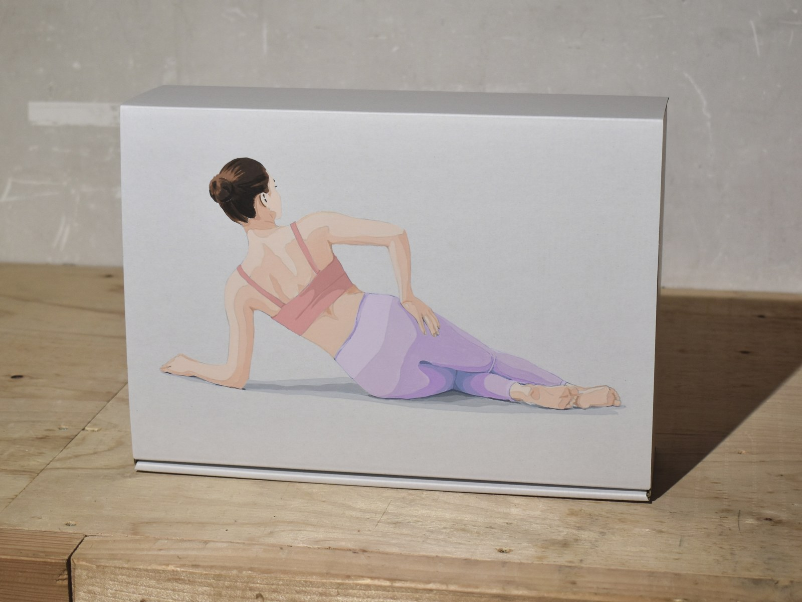</a>  
<b>Farrago — 1/5</b> 
2026 
Acrylic paint, Painted on a box 
¥22,000  
<a href="https://square.link/u/ymH7itqt">Purchase Work</a>
</td>
</tr>

<tr>
<td align="center" valign="bottom" width="33%" height="420">
<a href="/assets/berlin-sick-sok-out-src/farrago-2.jpg?full" target="_blank" rel="noopener" title="Open larger image in a new window">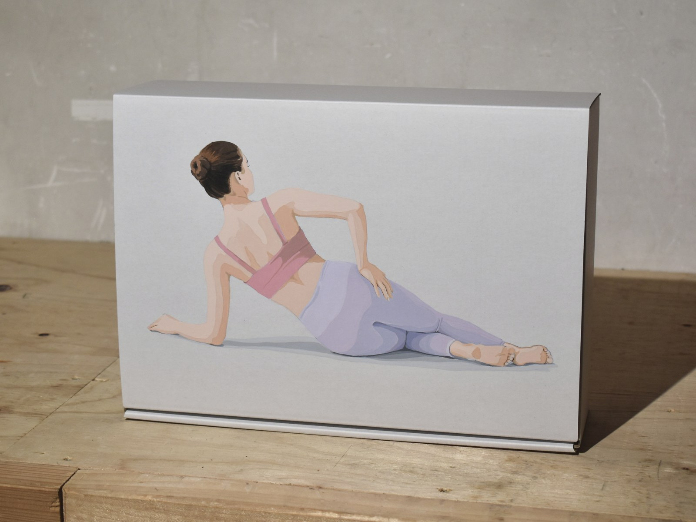</a>  
<b>Farrago — 2/5</b> 
2026 
Acrylic paint, Painted on a box 
¥22,000  
<a href="https://square.link/u/ymH7itqt">Purchase Work</a>
</td>

<td align="center" valign="bottom" width="33%" height="420">
<a href="/assets/berlin-sick-sok-out-src/farrago-3.jpg?full" target="_blank" rel="noopener" title="Open larger image in a new window">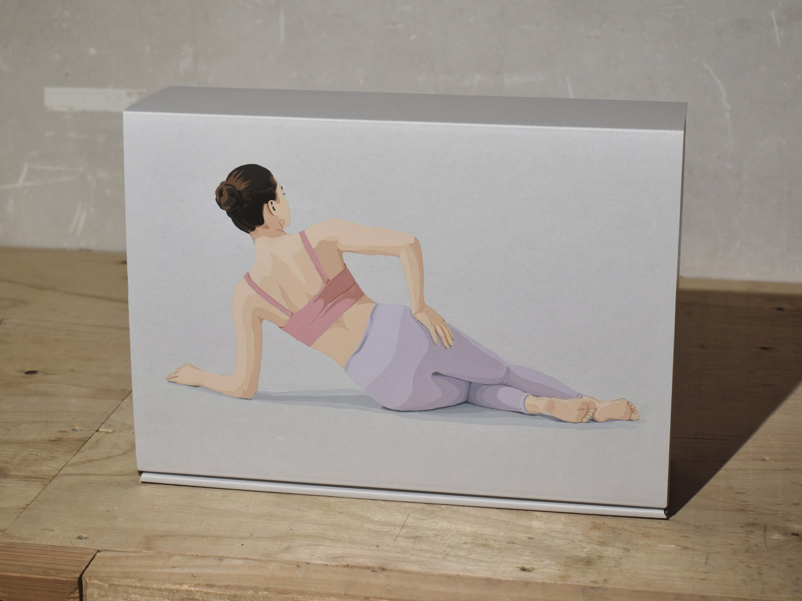</a>  
<b>Farrago — 3/5</b> 
2026 
Acrylic paint, Painted on a box 
¥22,000  
<a href="https://square.link/u/ymH7itqt">Purchase Work</a>
</td>

<td align="center" valign="bottom" width="33%" height="420">
<a href="/assets/berlin-sick-sok-out-src/farrago-4.jpg?full" target="_blank" rel="noopener" title="Open larger image in a new window">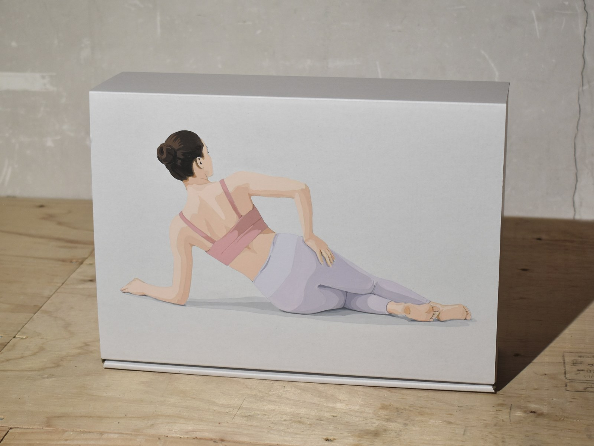</a>  
<b>Farrago — 4/5</b> 
2026 
Acrylic paint, Painted on a box 
¥22,000  
<a href="https://square.link/u/ymH7itqt">Purchase Work</a>
</td>
</tr>

<tr>
<td align="center" valign="bottom" width="33%" height="420">
<a href="/assets/berlin-sick-sok-out-src/farrago-5.jpg?full" target="_blank" rel="noopener" title="Open larger image in a new window">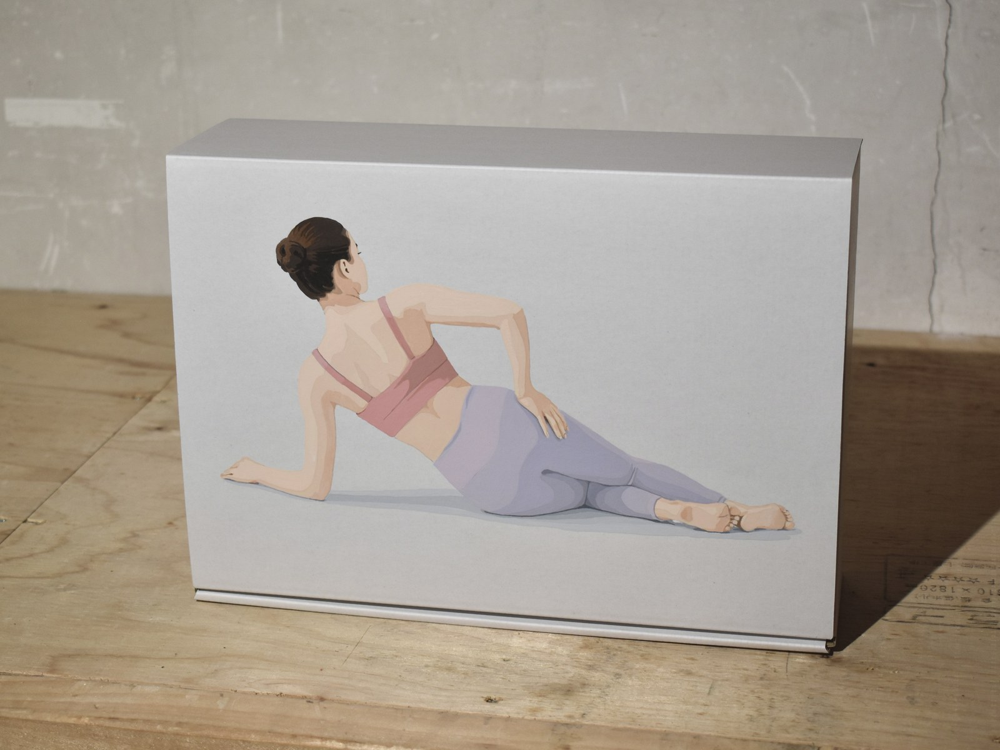</a>  
<b>Farrago — 5/5</b> 
2026 
Acrylic paint, Painted on a box 
¥22,000  
<a href="https://square.link/u/ymH7itqt">Purchase Work</a>
</td>

<td align="center" valign="bottom" width="33%" height="420">
<a href="/assets/berlin-sick-sok-out-src/neko.jpg?full" target="_blank" rel="noopener" title="Open larger image in a new window">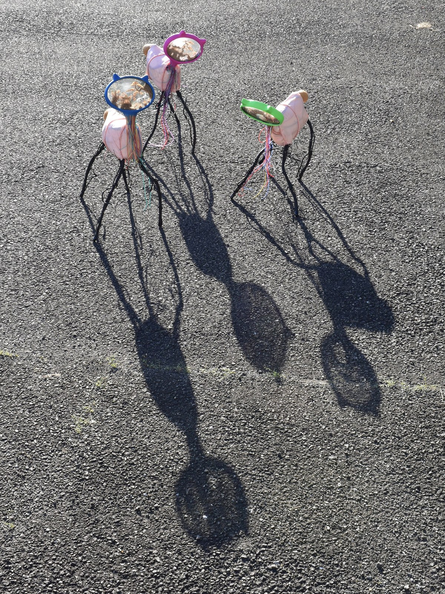</a>  
<b>ネコ</b> 
2026 
Mixed media 
1 piece: ¥55,000 
3-piece set: ¥135,000  
<a href="https://square.link/u/d7kItJ9F">Purchase 1 Piece</a> &nbsp;·&nbsp; <a href="https://square.link/u/bpadsGi0">Purchase 3-Piece Set</a>
</td>
</tr>
</table>

### BIRTHDAY STORIES — Negar Kaghazchi (2026)

**[Exhibition Page](/exhibitions/negar-kaghazchi-birthday-stories/)**

*The Most Expensive Piece of Cake* works can be purchased individually at ¥70,000 each, or as the complete set of seven for ¥420,000. For the complete set, please [contact us](mailto:threespacetokyo@gmail.com).

<table>
<tr>
<td align="center" valign="bottom" width="33%" height="420">
<a href="/assets/negar-kaghazchi-birthday-stories/there-are-at-least-three-large.jpg?full" target="_blank" rel="noopener" title="Open larger image in a new window">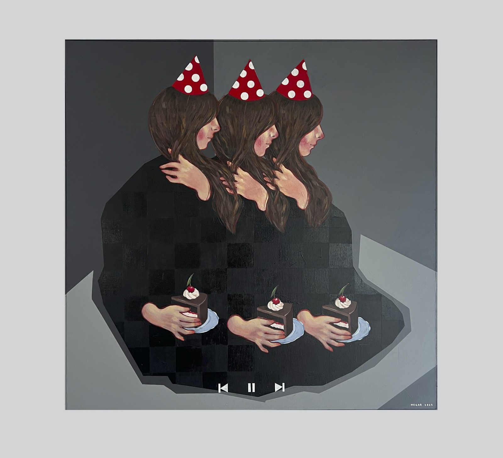</a>  
<b>There Are At Least Three!</b> 
2026 
Acrylic on canvas 
100 × 100 cm 
¥380,000  
<a href="https://square.link/u/l3QtXKO1">Purchase Work</a>
</td>

<td align="center" valign="bottom" width="33%" height="420">
<a href="/assets/negar-kaghazchi-birthday-stories/how-to-tie-a-ribbon-large.jpg?full" target="_blank" rel="noopener" title="Open larger image in a new window">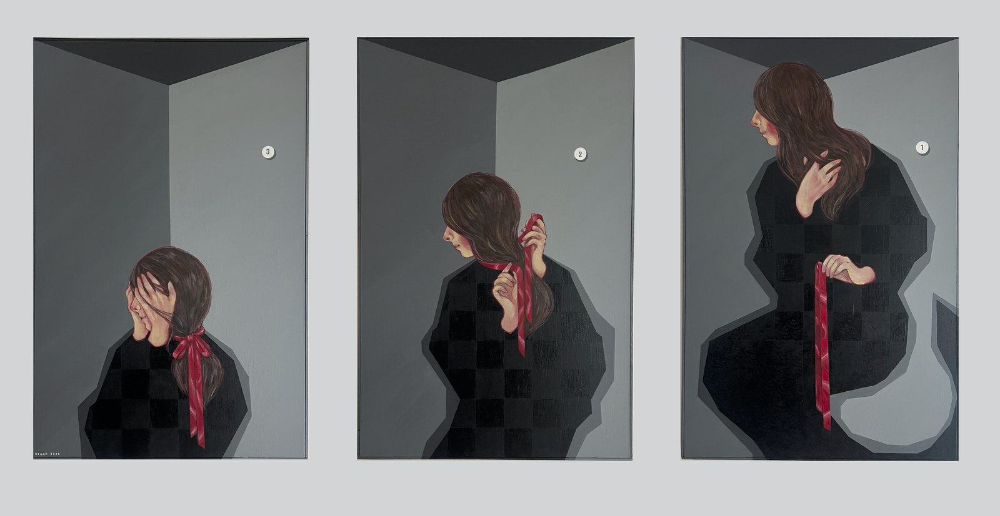</a>  
<b>How to Tie a Ribbon</b> 
2026 
Acrylic on canvas 
Triptych, 3 × 100 × 60 cm 
¥400,000  
<a href="https://square.link/u/73yM7ujB">Purchase Work</a>
</td>

<td align="center" valign="bottom" width="33%" height="420">
<a href="/assets/negar-kaghazchi-birthday-stories/most-expensive-piece-of-cake-piece1.jpg?full" target="_blank" rel="noopener" title="Open larger image in a new window">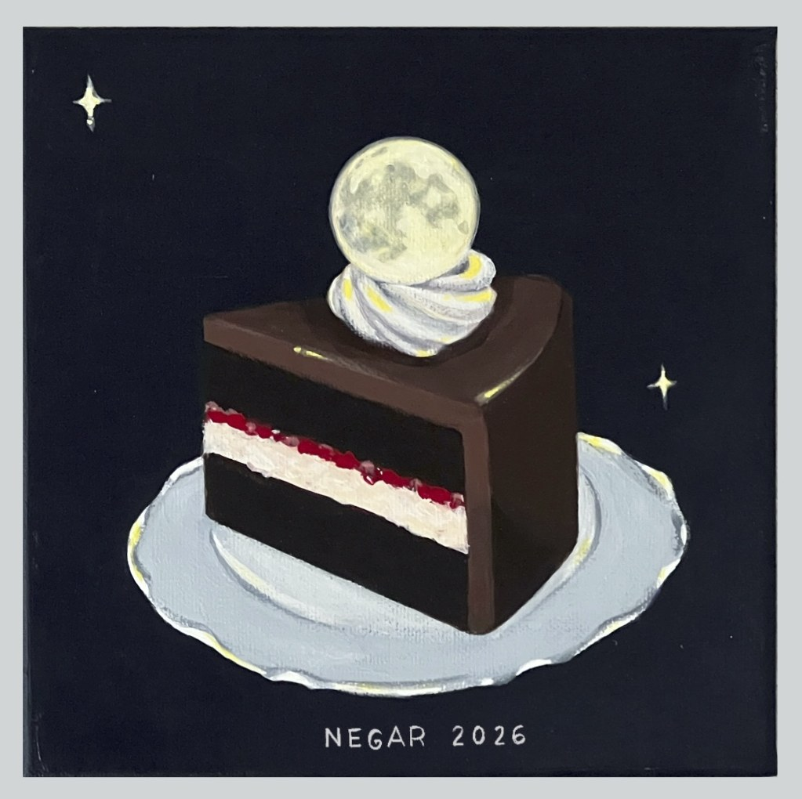</a>  
<b>The Most Expensive Piece of Cake — Piece 1</b> 
2026 
Acrylic on canvas 
20 × 20 cm 
¥70,000  
<a href="https://square.link/u/wGauHU32">Purchase Work</a>
</td>
</tr>

<tr>
<td align="center" valign="bottom" width="33%" height="420">
<a href="/assets/negar-kaghazchi-birthday-stories/most-expensive-piece-of-cake-piece2.jpg?full" target="_blank" rel="noopener" title="Open larger image in a new window">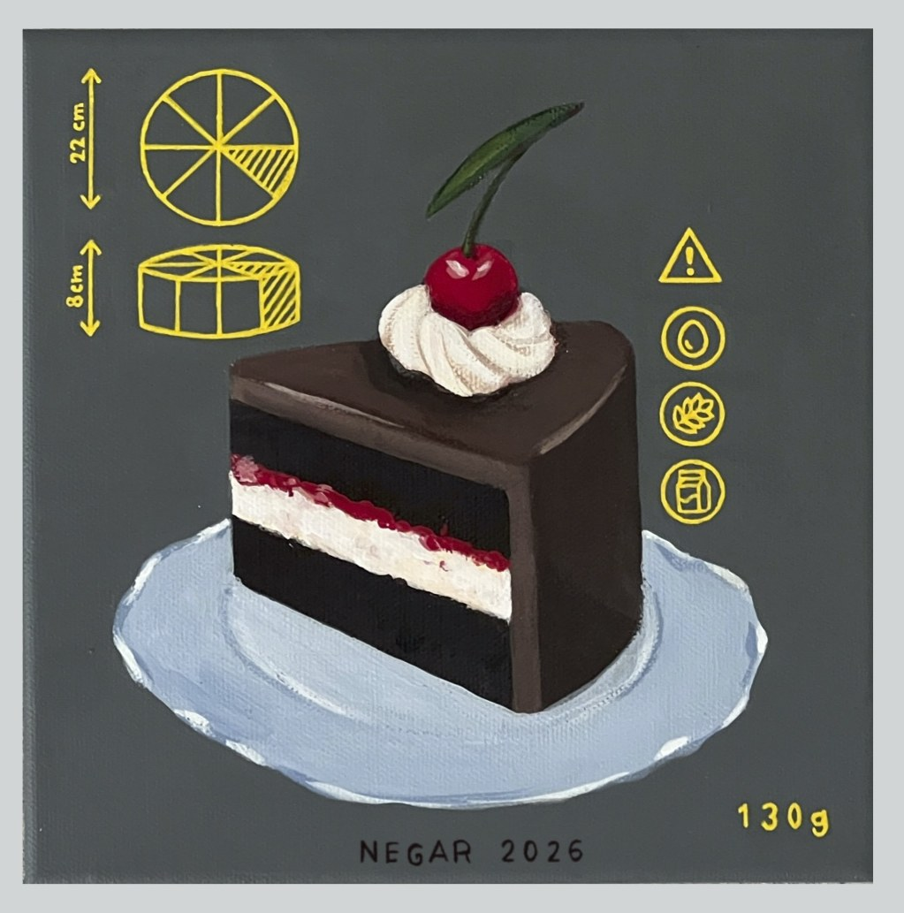</a>  
<b>The Most Expensive Piece of Cake — Piece 2</b> 
2026 
Acrylic on canvas 
20 × 20 cm 
¥70,000  
<a href="https://square.link/u/WWybK7zd">Purchase Work</a>
</td>

<td align="center" valign="bottom" width="33%" height="420">
<a href="/assets/negar-kaghazchi-birthday-stories/most-expensive-piece-of-cake-piece3.jpg?full" target="_blank" rel="noopener" title="Open larger image in a new window">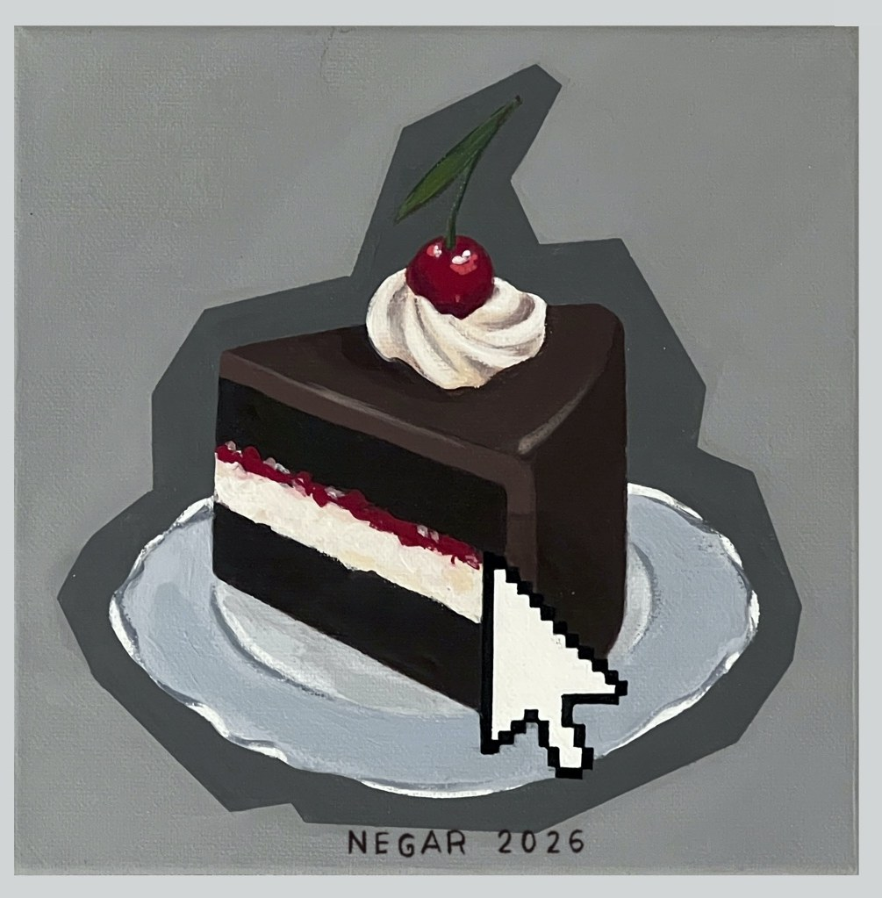</a>  
<b>The Most Expensive Piece of Cake — Piece 3</b> 
2026 
Acrylic on canvas 
20 × 20 cm 
¥70,000  
<a href="https://square.link/u/N963BzXK">Purchase Work</a>
</td>

<td align="center" valign="bottom" width="33%" height="420">
<a href="/assets/negar-kaghazchi-birthday-stories/most-expensive-piece-of-cake-piece4.jpg?full" target="_blank" rel="noopener" title="Open larger image in a new window">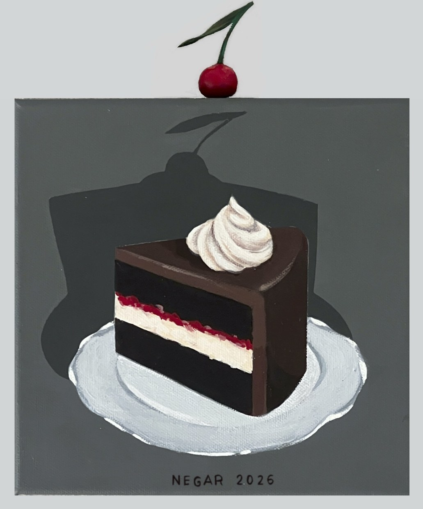</a>  
<b>The Most Expensive Piece of Cake — Piece 4</b> 
2026 
Acrylic on canvas 
20 × 20 cm 
¥70,000  
<a href="https://square.link/u/BUbzCUNL">Purchase Work</a>
</td>
</tr>

<tr>
<td align="center" valign="bottom" width="33%" height="420">
<a href="/assets/negar-kaghazchi-birthday-stories/most-expensive-piece-of-cake-piece5.jpg?full" target="_blank" rel="noopener" title="Open larger image in a new window">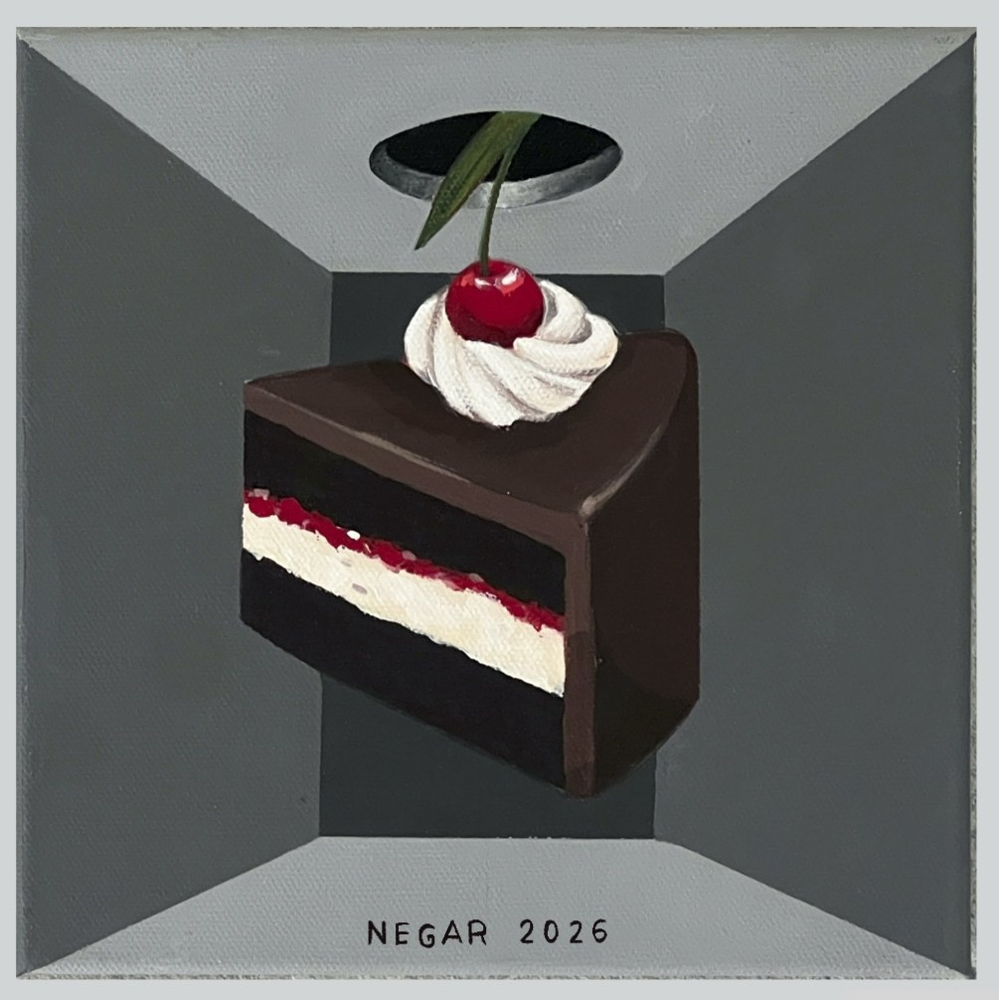</a>  
<b>The Most Expensive Piece of Cake — Piece 5</b> 
2026 
Acrylic on canvas 
20 × 20 cm 
¥70,000  
<a href="https://square.link/u/B1yC1wJ1">Purchase Work</a>
</td>

<td align="center" valign="bottom" width="33%" height="420">
<a href="/assets/negar-kaghazchi-birthday-stories/most-expensive-piece-of-cake-piece6.jpg?full" target="_blank" rel="noopener" title="Open larger image in a new window">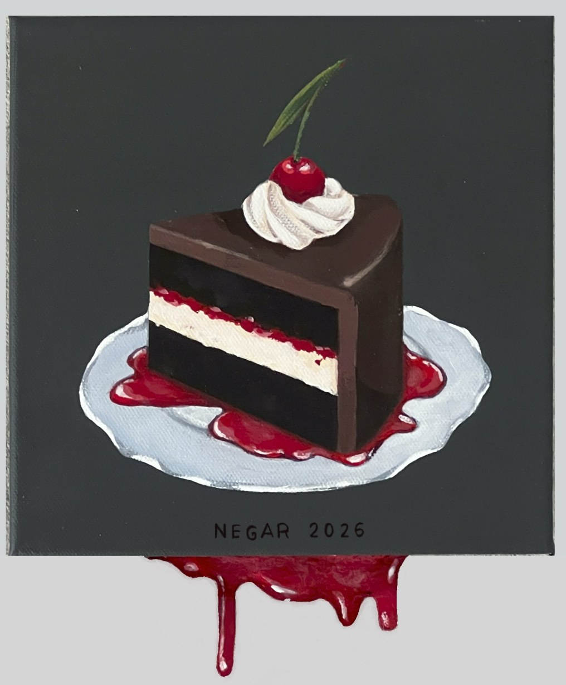</a>  
<b>The Most Expensive Piece of Cake — Piece 6</b> 
2026 
Acrylic on canvas 
20 × 20 cm 
¥70,000  
<a href="https://square.link/u/7bwmyDS8">Purchase Work</a>
</td>

<td align="center" valign="bottom" width="33%" height="420">
<a href="/assets/negar-kaghazchi-birthday-stories/most-expensive-piece-of-cake-piece8.jpg?full" target="_blank" rel="noopener" title="Open larger image in a new window">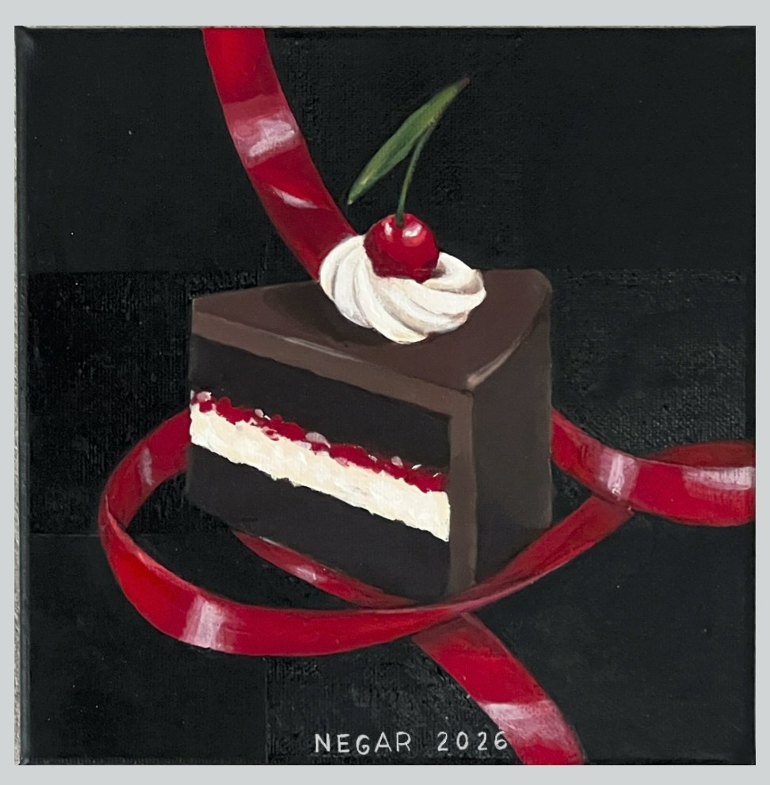</a>  
<b>The Most Expensive Piece of Cake — Piece 8</b> 
2026 
Acrylic on canvas 
20 × 20 cm 
¥70,000  
<a href="https://square.link/u/36caWLIJ">Purchase Work</a>
</td>
</tr>
</table>

### Spirits in the Rice Field — Yuko Uchida (2026)

**[Exhibition Page](/exhibitions/yuko-uchida-spirits-in-the-rice-field/)**

<table>
<tr>
<td align="center" valign="bottom" width="33%" height="420">
<a href="/assets/yuko-uchida-spirits-in-the-rice-field/Sun.jpg?full" target="_blank" rel="noopener" title="Open larger image in a new window">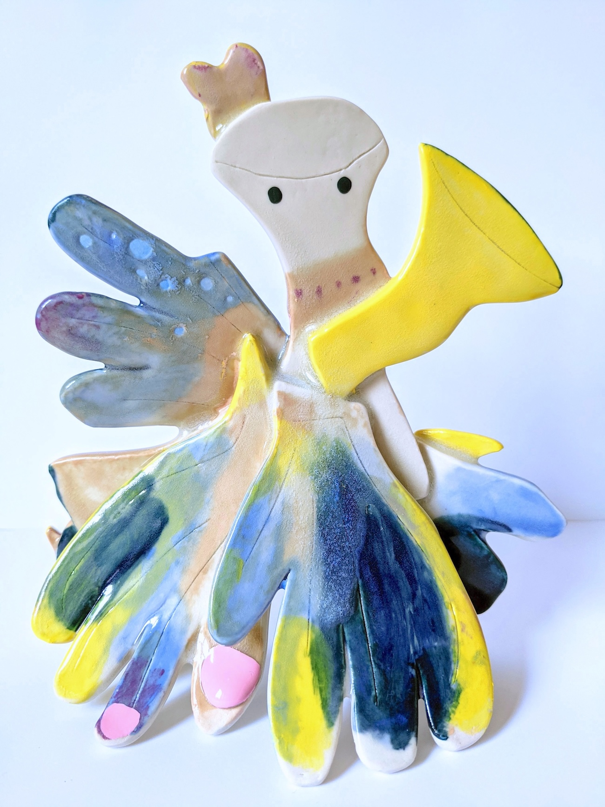</a>  
<b>Sun</b> 
2021 
Glazed ceramic 
20 × 13 × 3 cm 
¥70,000  
<a href="mailto:threespacetokyo@gmail.com">Contact Us</a>
</td>

<td align="center" valign="bottom" width="33%" height="420">
<a href="/assets/yuko-uchida-spirits-in-the-rice-field/Water.jpg?full" target="_blank" rel="noopener" title="Open larger image in a new window">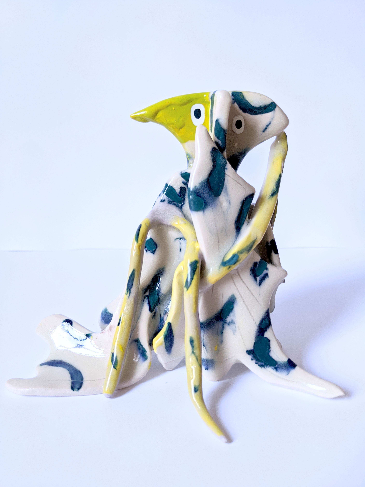</a>  
<b>Water</b> 
2021 
Glazed ceramic 
16 × 10 × 9 cm 
¥70,000  
<a href="mailto:threespacetokyo@gmail.com">Contact Us</a>
</td>

<td align="center" valign="bottom" width="33%" height="420">
<a href="/assets/yuko-uchida-spirits-in-the-rice-field/Cloud.jpg?full" target="_blank" rel="noopener" title="Open larger image in a new window">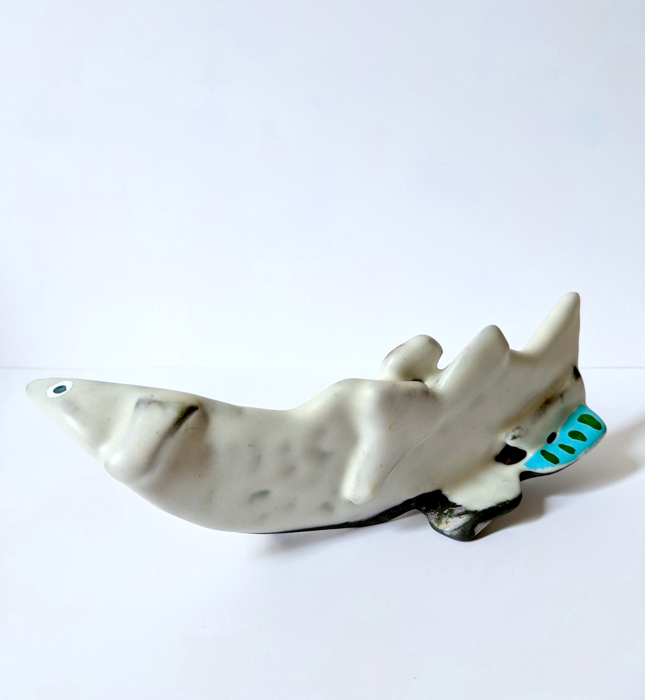</a>  
<b>Cloud</b> 
2021 
Glazed ceramic 
6 × 17 × 4 cm 
¥70,000  
<a href="mailto:threespacetokyo@gmail.com">Contact Us</a>
</td>
</tr>

<tr>
<td align="center" valign="bottom" width="33%" height="420">
<a href="/assets/yuko-uchida-spirits-in-the-rice-field/Soil.jpg?full" target="_blank" rel="noopener" title="Open larger image in a new window">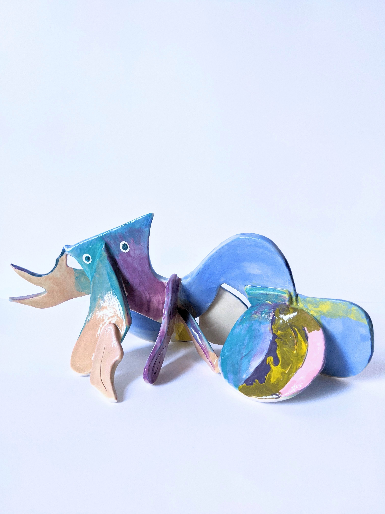</a>  
<b>Soil</b> 
2021 
Glazed ceramic 
6 × 14 × 7 cm 
¥70,000  
<a href="mailto:threespacetokyo@gmail.com">Contact Us</a>
</td>

<td align="center" valign="bottom" width="33%" height="420">
<a href="/assets/yuko-uchida-spirits-in-the-rice-field/Wind.jpg?full" target="_blank" rel="noopener" title="Open larger image in a new window">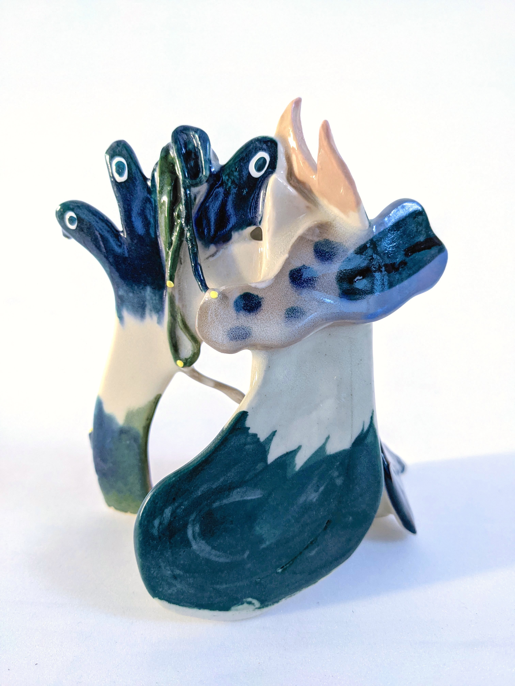</a>  
<b>Wind</b> 
2021 
Glazed ceramic 
12 × 8 × 5 cm 
¥70,000  
<a href="mailto:threespacetokyo@gmail.com">Contact Us</a>
</td>

<td align="center" valign="bottom" width="33%" height="420">
<a href="/assets/yuko-uchida-spirits-in-the-rice-field/Insect.jpg?full" target="_blank" rel="noopener" title="Open larger image in a new window">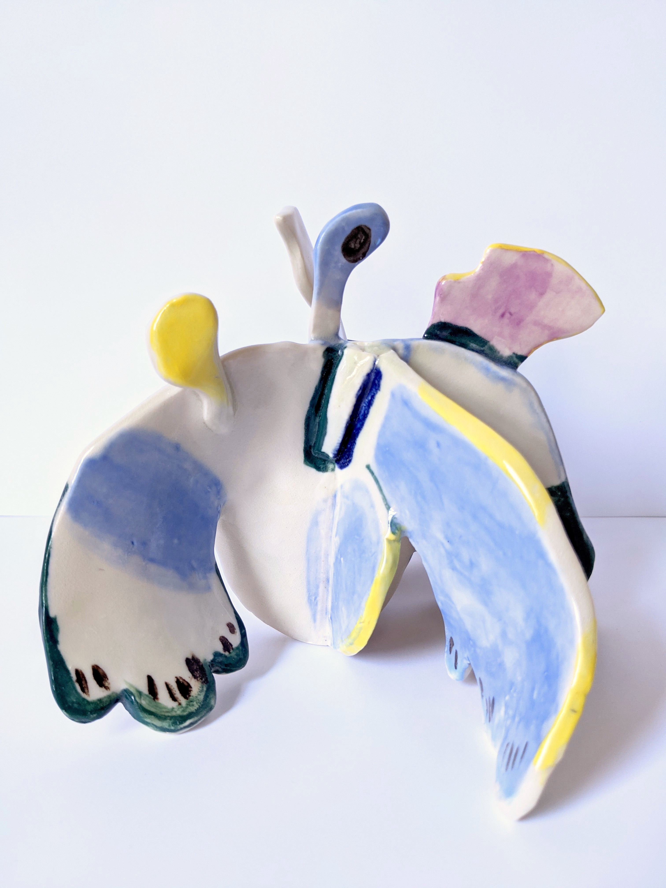</a>  
<b>Insect</b> 
2021 
Glazed ceramic 
13 × 18 × 16 cm 
¥70,000  
<a href="mailto:threespacetokyo@gmail.com">Contact Us</a>
</td>
</tr>

<tr>
<td align="center" valign="bottom" width="33%" height="420">
<a href="/assets/yuko-uchida-spirits-in-the-rice-field/Farmer.jpg?full" target="_blank" rel="noopener" title="Open larger image in a new window">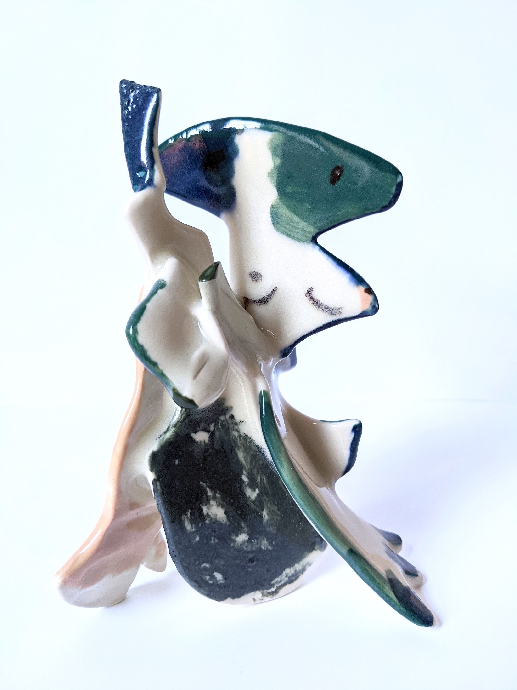</a>  
<b>Farmer</b> 
2021 
Glazed ceramic 
14 × 9 × 6 cm 
¥70,000  
<a href="mailto:threespacetokyo@gmail.com">Contact Us</a>
</td>

<td align="center" valign="bottom" width="33%" height="420">
<a href="/assets/yuko-uchida-spirits-in-the-rice-field/Embracing.jpg?full" target="_blank" rel="noopener" title="Open larger image in a new window">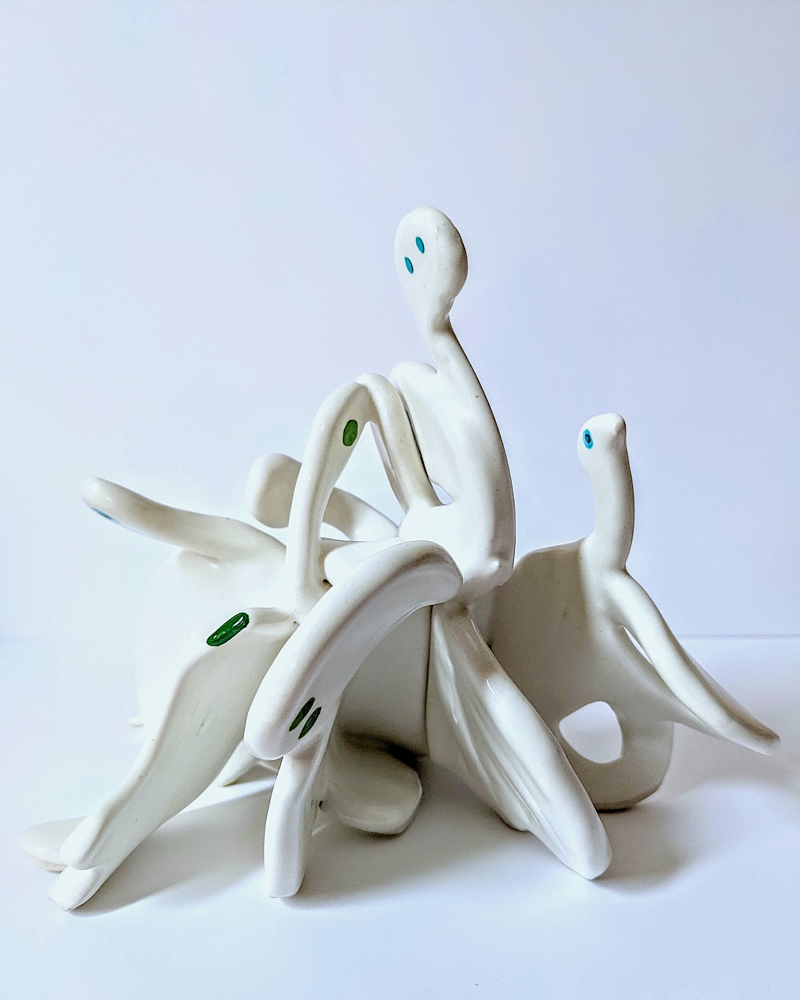</a>  
<b>Embracing</b> 
2020 
Glazed ceramic 
18 × 18 × 15 cm 
SOLD
</td>

<td align="center" valign="bottom" width="33%" height="420">
<a href="/assets/yuko-uchida-spirits-in-the-rice-field/Whisper.jpg?full" target="_blank" rel="noopener" title="Open larger image in a new window">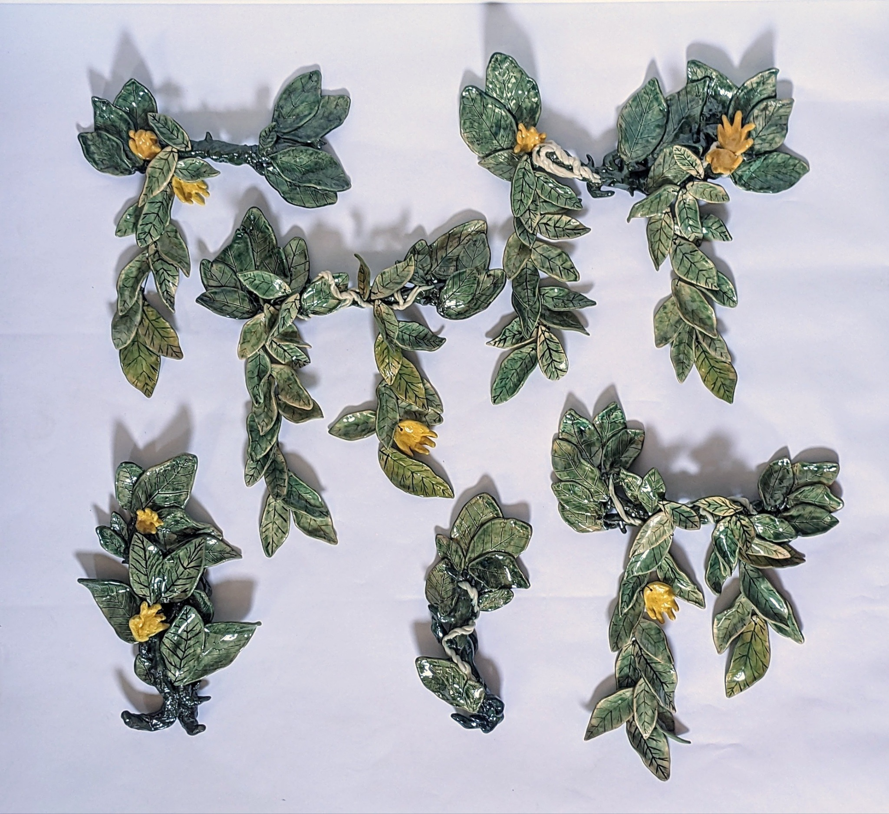</a>  
<b>Whisper in a shadow</b> 
2025 
Glazed ceramic, wire 
Variable dimensions 
¥70,000 each  
<a href="mailto:threespacetokyo@gmail.com">Contact Us</a>
</td>
</tr>

<tr>
<td align="center" valign="bottom" width="33%" height="420">
<a href="/assets/yuko-uchida-spirits-in-the-rice-field/Mask.jpg?full" target="_blank" rel="noopener" title="Open larger image in a new window">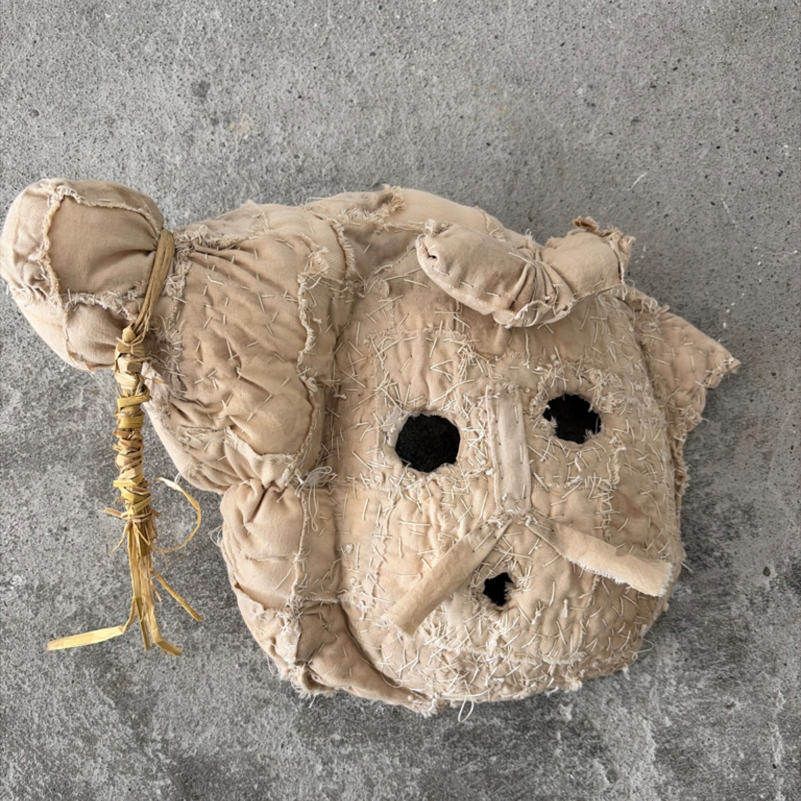</a>  
<b>Mask</b> 
2026 
Hand sew-plants dyed fabric, papermache 
Variable dimensions 
¥130,000 each  
<a href="mailto:threespacetokyo@gmail.com">Contact Us</a>
</td>
</tr>
</table>
